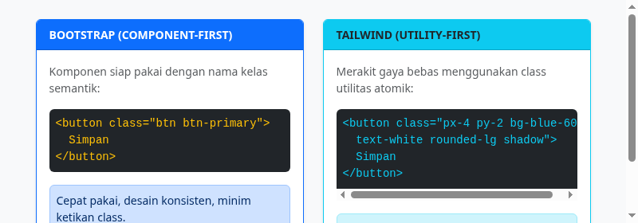

#programming 

**Bootstrap** adalah salah satu framework CSS sumber terbuka (*open-source*) paling populer di dunia yang dirancang dengan pendekatan **Component-First**. Dibuat pertama kali oleh tim pengembang Twitter (Mark Otto dan Jacob Thornton), Bootstrap menyediakan ratusan komponen antarmuka siap pakai yang langsung terlihat rapi, konsisten, dan responsif.

Berbeda dengan Tailwind CSS yang mengharuskan Anda merakit komponen dari class-class atomik tingkat rendah, Bootstrap memberikan class semantik tingkat tinggi seperti `.btn`, `.btn-primary`, `.card`, `.modal`, dan `.navbar`.

---

## 1. Filosofi Component-First vs Utility-First

| Aspek | Bootstrap (Component-First) | Tailwind CSS (Utility-First) |
| :--- | :--- | :--- |
| **Konsep Dasar** | Menyediakan komponen siap pakai yang sudah memiliki gaya default. | Menyediakan class utilitas atomik kecil untuk merakit gaya sendiri. |
| **Kecepatan Awal** | Sangat cepat untuk membuat prototipe, dashboard admin, atau MVP. | Butuh waktu sedikit lebih lama di awal untuk merakit elemen tombol/kartu. |
| **Keseragaman Desain** | Sangat konsisten karena mengikuti panduan desain baku Bootstrap. | Bebas tanpa batas, tergantung imajinasi dan sistem desain developer. |
| **Panjang Class di HTML** | Pendek dan ringkas (contoh: `class="btn btn-primary"`). | Lebih panjang dan deskriptif (contoh: `class="px-4 py-2 bg-blue-600 text-white rounded"`). |

---

## 2. Evolusi Penting pada Bootstrap 5

Jika Anda pernah mendengar bahwa Bootstrap berat atau lambat karena membutuhkan jQuery, hal tersebut sudah tidak berlaku lagi. Bootstrap 5 (versi modern saat ini) membawa perubahan arsitektur besar-besaran:

1. **Penghapusan Total Dependensi jQuery**:
   Seluruh komponen interaktif (Modal, Dropdown, Carousel) kini ditulis menggunakan **Vanilla JavaScript modern**. Hasilnya, performa halaman web meningkat drastis dan ukuran bundle menjadi jauh lebih ringan.
2. **Penghentian Dukungan Internet Explorer (IE)**:
   Dengan ditinggalkannya IE, Bootstrap 5 memanfaatkan fitur-fitur peramban mutakhir seperti variabel CSS asli (*CSS Custom Properties*) dan pseudo-class modern.
3. **Sistem Warna Halus Baru (*Subtle Colors*)**:
   Bootstrap 5.3 memperkenalkan varian warna modern ber-opacity rendah yang elegan, seperti `bg-primary-subtle`, `text-primary-emphasis`, dan `border-primary-subtle`.
4. **Komponen Modern Baru**:
   Menambahkan komponen laci samping (*Offcanvas*), label formulir melayang (*Floating Labels*), dan Accordion independen.
5. **Dukungan Dark Mode Bawaan**:
   Bootstrap 5.3 ke atas kini memiliki dukungan tema gelap otomatis cukup dengan menambahkan atribut `data-bs-theme="dark"` pada tag HTML.

---

## 3. Kapan Sebaiknya Memilih Bootstrap?

* Saat Anda perlu membangun **Dashboard Admin, Panel Internal, atau Aplikasi CRUD** dengan cepat tanpa desainer UI/UX khusus.
* Saat Anda bekerja dalam tim besar dengan pemrogram backend yang ingin merakit antarmuka web yang rapi tanpa pusing memikirkan aturan styling CSS.
* Saat Anda membutuhkan dokumentasi yang sangat matang dan komponen interaktif yang sudah teruji aksesibilitasnya (ARIA-compliant) di jutaan website dunia.
