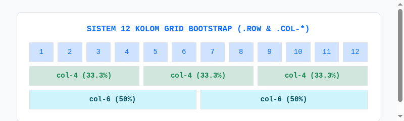

#programming 

Sistem grid adalah pondasi utama tata letak responsif di Bootstrap. Dibangun di atas model Flexbox, sistem grid Bootstrap membagi satu baris horizontal menjadi **12 kolom imajiner**.



---

## 1. Anatomi Tiga Tingkat Grid

Sistem grid Bootstrap memiliki aturan hierarki ketat yang terdiri dari tiga komponen:

```text
.container (atau .container-fluid)
  └── .row
        └── .col-*
```

1. **Container (`.container`)**:
   Wadah terluar yang membatasi lebar maksimum halaman dan menengahkan konten secara horizontal dengan margin auto. Gunakan `.container-fluid` jika Anda ingin konten melebar 100% selebar layar tanpa batas maksimum.
2. **Row (`.row`)**:
   Pembungkus baris horizontal yang mengaktifkan flexbox. **Aturan baku**: elemen anak langsung dari `.row` **wajib** berupa kolom (`.col-*`). Jangan pernah meletakkan elemen lain di dalam row tanpa dibungkus col.
3. **Column (`.col-*`)**:
   Blok yang menentukan berapa banyak jatah kolom dari total 12 kolom yang akan diambil oleh suatu elemen.

---

## 2. Enam Breakpoint Responsif Bootstrap 5

Bootstrap menggunakan 6 tingkat henti (*breakpoint*) berbasis media query `min-width`:

| Breakpoint | Notasi Class | Lebar Layar Minimal | Target Perangkat Tipikal |
| :--- | :--- | :--- | :--- |
| **Extra Small** | `.col-*` | `< 576px` | Ponsel layar portrait |
| **Small** | `.col-sm-*` | `≥ 576px` | Ponsel layar landscape / mini tablet |
| **Medium** | `.col-md-*` | `≥ 768px` | Komputer tablet (iPad) |
| **Large** | `.col-lg-*` | `≥ 992px` | Laptop dan monitor komputer desktop |
| **Extra Large** | `.col-xl-*` | `≥ 1200px` | Monitor desktop layar besar |
| **Extra Extra Large** | `.col-xxl-*` | `≥ 1400px` | Layar televisi / monitor ultra-wide |

---

## 3. Contoh Pola Tata Letak Responsif

Perhatikan contoh umum: tata letak 1 kolom di HP, 2 kolom di tablet, dan 3 kolom di laptop:

```html
<div class="container">
  <div class="row">
    <!-- Setiap kolom menghabiskan 12 kolom di HP, 6 kolom di tablet, dan 4 kolom di laptop -->
    <div class="col-12 col-md-6 col-lg-4">
      <div class="p-3 bg-white border rounded">Kartu 1</div>
    </div>
    <div class="col-12 col-md-6 col-lg-4">
      <div class="p-3 bg-white border rounded">Kartu 2</div>
    </div>
    <div class="col-12 col-md-6 col-lg-4">
      <div class="p-3 bg-white border rounded">Kartu 3</div>
    </div>
  </div>
</div>
```

---

## 4. Fitur Pintar Grid Bootstrap

### A. Kolom Otomatis (*Auto-Layout Columns*)
Jika Anda hanya menulis `.col` tanpa angka, Bootstrap akan membagi lebar baris secara sama rata untuk semua kolom yang ada:

```html
<div class="row">
  <div class="col">Kolom 1 (Otomatis 33.3%)</div>
  <div class="col">Kolom 2 (Otomatis 33.3%)</div>
  <div class="col">Kolom 3 (Otomatis 33.3%)</div>
</div>
```

### B. Lebar Menyesuaikan Konten (`.col-auto`)
Gunakan `.col-auto` jika Anda ingin sebuah kolom lebarnya hanya sebesar teks atau tombol di dalamnya, sedangkan kolom di sebelahnya menghabiskan sisa ruang:

```html
<div class="row">
  <div class="col">Konten Utama Melebar</div>
  <div class="col-auto">Tombol Sempit</div>
</div>
```

### C. Jarak Celah Antar Kolom (*Gutters*) dengan `g-*`
Secara default, kolom memiliki celah padding (*gutter*). Anda dapat mengatur atau menghapus celah ini pada level `.row`:
* `g-0` : Menghapus seluruh celah antar kolom (jarak rapat 0px).
* `g-1` s/d `g-5` : Mengatur celah dari 4px hingga 48px.
* `gx-*` : Mengatur celah horizontal saja.
* `gy-*` : Mengatur celah vertikal saat kolom turun ke baris baru.
