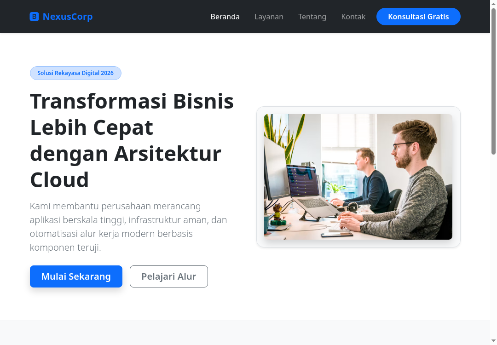
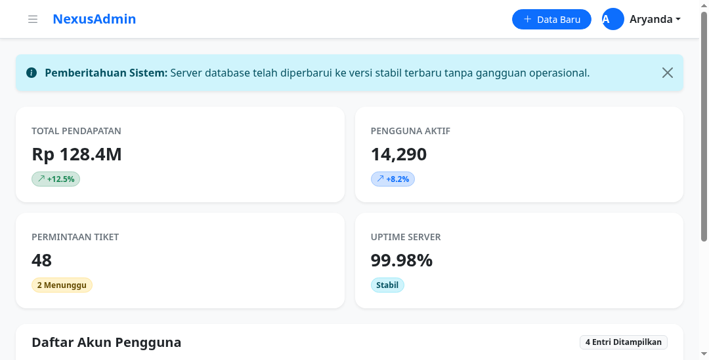

# Catatan Praktikum Bootstrap 5

Folder ini berisi kumpulan proyek antarmuka web modern menggunakan Bootstrap 5 (versi 5.3+). Seluruh berkas HTML menggunakan Bootstrap CDN resmi sehingga dapat langsung dibuka di peramban web (browser) Anda tanpa memerlukan instalasi Node.js atau kompilasi Sass.

---

## Daftar Proyek Latihan

### 1. [01-Company Landing Page](01-company-landing-page/index.html)
* **Fokus Materi**:
  - Sticky Navbar gelap dengan logo ikon Bootstrap Icons dan tombol aksi melengkung kapsul (`rounded-pill`).
  - Hero Section responsif dengan teks besar (`display-5`), paragraf pengantar (`lead`), dan gambar mockup.
  - Sistem Grid 12 Kolom dengan 3 kartu layanan (`card h-100 border-0 shadow-sm rounded-4`).
  - Kotak pendaftaran newsletter dengan grup input tombol (`input-group`).
* **Pratinjau Desain**:
  

---

### 2. [02-Admin Dashboard](02-admin-dashboard/index.html)
* **Fokus Materi**:
  - Panel samping tersembunyi (*Offcanvas Drawer*) yang meluncur dari kiri layar (`data-bs-toggle="offcanvas"`).
  - Jendela pop-up modal tambah akun pengguna terpusat (`modal-dialog-centered`).
  - Spanduk pemberitahuan yang dapat ditutup sendiri (`alert alert-info alert-dismissible`).
  - Ringkasan KPI statistik dengan badge tren warna halus (`bg-success-subtle`).
  - Tabel data responsif dengan efek sorot kursor (`table table-hover align-middle`).
* **Pratinjau Desain**:
  
