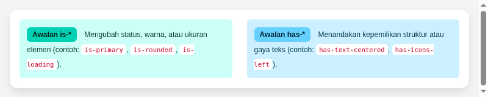

#programming 

Bulma adalah framework CSS modern sumber terbuka yang dibangun 100% berbasis Flexbox dan sama sekali tidak menyertakan JavaScript bawaan (CSS-only). Dibuat oleh Jeremy Thomas pada tahun 2016, Bulma dirancang dengan pendekatan human-first syntax, yaitu penamaan class yang sangat alami, mudah dibaca layaknya kalimat bahasa Inggris, dan modular.



## Filosofi Utama Bulma CSS

Berbeda dengan framework CSS pada umumnya yang sering memaketkan plugin JavaScript atau mengharuskan kompilasi utility yang kompleks, Bulma memegang teguh tiga prinsip filosofis:

1. **100% CSS-Only (Framework Agnostic)**: Bulma murni berisikan styling CSS. Tidak ada keterikatan dengan runtime JavaScript tertentu seperti jQuery atau modul JS internal. Anda bebas menggabungkan Bulma dengan vanilla JavaScript, React, Vue, Angular, Svelte, Alpine.js, HTMX, maupun server-side rendering (Laravel Blade, Django, Ruby on Rails).
2. **Sintaks Manusiawi dan Terstruktur (Readable Modifiers)**: Class modifier diatur dengan konvensi prefix yang jelas, terutama `is-*` (mengatur wujud, status, warna, dan dimensi) serta `has-*` (mengatur kepemilikan gaya spesifik seperti warna latar dan bayangan).
3. **Berbasis Flexbox Murni Secara Penuh**: Sistem layout Bulma dibangun di atas fondasi CSS Flexbox modern. Hal ini membuat perataan elemen, distribusi ruang, dan pembuatan grid responsif menjadi sangat konsisten tanpa jebakan float atau clearfix lawas.

## Perbandingan Bulma vs Bootstrap vs Tailwind CSS

Untuk memahami kapan waktu yang tepat memilih Bulma dalam proyek pengembangan web, mari tinjau komparasi ketiga framework berikut:

| Parameter | Bulma CSS | Bootstrap 5 | Tailwind CSS |
| :--- | :--- | :--- | :--- |
| **Pendekatan Desain** | Berbasis Komponen Semantik | Berbasis Komponen Tradisional | Utility-First |
| **Ketergantungan JS** | Murni CSS (0 KB JS bawaan) | Membutuhkan Bootstrap JS / Popper | Murni Utility (JS hanya via builder) |
| **Kurva Pembelajaran** | Sangat Rendah (ramah pemula) | Rendah hingga Menengah | Menengah (butuh hafalan utility class) |
| **Gaya Penamaan Class** | Sintaks alami (`is-primary`, `is-half`) | Format singkatan (`btn-primary`, `col-6`) | Utility atomik (`bg-blue-600`, `w-1/2`) |
| **Estetika Default** | Modern, rapi, bersih, dan modern | Fungsional korporat standar | Kosong (harus dirakit dari nol) |
| **Kebebasan Kustomisasi** | Tinggi via Sass dan CSS Variables | Menengah via Sass variables | Sangat tinggi via config CSS/JS |

## Anatomi Penamaan Class: Pola `is-*` dan `has-*`

Salah satu daya tarik terbesar Bulma adalah keterbacaan kodenya. Pengembang tidak perlu mengingat singkatan-singkatan yang membingungkan.

### 1. Pola Modifier Status dan Bentuk (`is-*`)
Class yang diawali dengan `is-` digunakan untuk mengubah warna, ukuran, bentuk, serta status elemen:
- **Warna tema**: `is-primary`, `is-link`, `is-info`, `is-success`, `is-warning`, `is-danger`.
- **Ukuran**: `is-small`, `is-normal`, `is-medium`, `is-large`.
- **Bentuk dan perilaku**: `is-rounded`, `is-outlined`, `is-inverted`, `is-fullwidth`.
- **Status interaktif**: `is-loading`, `is-active`, `is-focused`, `is-hovered`.

Contoh implementasi tombol:
```html
<button class="button is-primary is-medium is-rounded is-loading">
  Menyimpan Data
</button>
```

### 2. Pola Helper dan Properti Teks (`has-*`)
Class yang diawali dengan `has-` digunakan ketika sebuah elemen memiliki atau mengandung karakteristik gaya visual tertentu:
- **Warna teks dan latar**: `has-text-primary`, `has-text-white`, `has-background-light`, `has-background-dark`.
- **Perataan teks**: `has-text-centered`, `has-text-left`, `has-text-right`, `has-text-justified`.
- **Karakteristik teks**: `has-text-weight-bold`, `has-text-weight-light`, `has-text-weight-semibold`.
- **Elemen pendamping**: `has-addons`, `has-icons-left`, `has-icons-right`.

Contoh implementasi kotak dengan penataan teks:
```html
<div class="box has-background-primary-light has-text-centered">
  <p class="has-text-primary-dark has-text-weight-semibold">
    Notifikasi: Akun Anda berhasil diperbarui ke paket premium.
  </p>
</div>
```

## Kelebihan dan Tantangan Menggunakan Bulma

### Kelebihan
- **Tidak ada konflik JavaScript**: Anda dapat menggunakan library interaktivitas modern apapun tanpa bentrok dengan script bawaan framework.
- **Desain default yang sangat estetis**: Tanpa kustomisasi rumit sekalipun, tampilan awal Bulma sudah tampak modern, elegan, dan proporsional.
- **Dokumentasi yang sangat terstruktur**: Sangat mudah dicari dan dicontohkan secara interaktif.
- **Dukungan variabel CSS modern (Bulma v1.0)**: Penggantian tema dan dark mode dapat dilakukan secara instan di level browser.

### Tantangan
- **Interaktivitas modal dan navbar harus dikontrol sendiri**: Karena tidak ada script bawaan, fitur seperti menu toggle hamburger navbar atau pembukaan dialog popup (modal) memerlukan beberapa baris kode JavaScript buatan Anda sendiri (atau integrasi Alpine/Vue/React).

---
Pelajari langkah berikutnya pada modul instalasi: [02. Instalasi dan Setup](02.%20Instalasi%20dan%20Setup.md).
