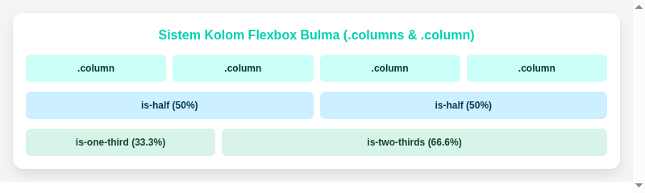

#programming 

Sistem kolom dalam Bulma adalah salah satu fitur paling elegan dan mudah digunakan di dunia frontend. Dibangun murni di atas CSS Flexbox, sistem ini menghilangkan kebutuhan perhitungan lebar persentase manual atau float clearing yang rumit.



## 1. Konsep Dasar: `.columns` dan `.column`

Untuk membuat deretan kolom horizontal, bungkus elemen kolom di dalam container dengan class `.columns`, lalu berikan class `.column` pada setiap anak di dalamnya.

```html
<div class="columns">
  <div class="column">Kolom Pertama</div>
  <div class="column">Kolom Kedua</div>
  <div class="column">Kolom Ketiga</div>
  <div class="column">Kolom Keempat</div>
</div>
```

Secara default, Flexbox akan membagi lebar sama rata kepada setiap `.column`. Jika ada 4 kolom, masing-masing otomatis mendapat porsi 25%. Jika ada 3 kolom, masing-masing mendapat 33.33%.

## 2. Ukuran Kolom Berdasarkan Pecahan (Fractional Modifiers)

Bulma menyediakan modifier pecahan yang sangat ekspresif untuk menentukan lebar kolom secara spesifik:

| Modifier Class | Porsi Lebar | Persentase |
| :--- | :--- | :--- |
| `is-three-quarters` | 3/4 lebar | 75% |
| `is-two-thirds` | 2/3 lebar | 66.66% |
| `is-half` | 1/2 lebar | 50% |
| `is-one-third` | 1/3 lebar | 33.33% |
| `is-one-quarter` | 1/4 lebar | 25% |
| `is-full` | Penuh | 100% |

Contoh tata letak konten utama dan bilah samping (sidebar):

```html
<div class="columns">
  <!-- Area Konten Utama (2/3 lebar) -->
  <div class="column is-two-thirds">
    <div class="box">Area Konten Utama</div>
  </div>
  
  <!-- Sidebar Kanan (1/3 lebar) -->
  <div class="column is-one-third">
    <div class="box">Widget Sidebar</div>
  </div>
</div>
```

## 3. Sistem Grid 12 Kolom Tradisional

Bagi pengembang yang terbiasa dengan sistem grid 12 kolom seperti pada Bootstrap, Bulma juga menyediakan modifier numerik mulai dari `is-1` sampai `is-12`:

```html
<div class="columns">
  <div class="column is-8">
    <div class="box">Lebar 8 dari 12 kolom (66.6%)</div>
  </div>
  <div class="column is-4">
    <div class="box">Lebar 4 dari 12 kolom (33.3%)</div>
  </div>
</div>
```

## 4. Jarak Geser Kolom (Column Offsets)

Untuk memberikan ruang kosong (margin horizontal) di sisi kiri kolom, gunakan modifier offset:
- Berdasarkan pecahan: `is-offset-half`, `is-offset-one-third`, `is-offset-one-quarter`.
- Berdasarkan angka: `is-offset-1` sampai `is-offset-11`.

Contoh formulir di tengah layar:
```html
<div class="columns">
  <!-- Kolom selebar 6 bagian yang digeser 3 bagian dari kiri agar berada persis di tengah -->
  <div class="column is-6 is-offset-3">
    <div class="box">Formulir Login Terpusat</div>
  </div>
</div>
```

## 5. Fitur Penataan Kolom Lanjutan

### A. Perataan Vertikal (`is-vcentered`)
Ketika kolom-kolom memiliki tinggi konten yang berbeda, tambahkan class `is-vcentered` pada elemen pembungkus `.columns` untuk meratakan isi kolom secara vertikal di garis tengah.

```html
<div class="columns is-vcentered">
  <div class="column is-8">
    <p class="title is-4">Judul Artikel Panjang</p>
    <p>Penjelasan detail dengan beberapa paragraf informasi penting.</p>
  </div>
  <div class="column is-4 has-text-centered">
    <button class="button is-primary is-large">Aksi Cepat</button>
  </div>
</div>
```

### B. Baris Multiline (`is-multiline`)
Secara default, Flexbox akan memaksakan semua kolom berada dalam satu baris. Jika Anda memiliki banyak kartu produk yang ingin membungkus ke baris berikutnya saat lebar total melebihi 100%, gunakan `is-multiline`:

```html
<div class="columns is-multiline">
  <div class="column is-one-third">Kartu 1</div>
  <div class="column is-one-third">Kartu 2</div>
  <div class="column is-one-third">Kartu 3</div>
  <div class="column is-one-third">Kartu 4 (Turun ke baris baru)</div>
  <div class="column is-one-third">Kartu 5</div>
</div>
```

### C. Menghilangkan Gap Antarkolom (`is-gapless`)
Jika ingin kolom saling menempel tanpa jarak celah (margin gap):
```html
<div class="columns is-gapless">
  <div class="column is-half has-background-primary has-text-white p-4">Panel Kiri</div>
  <div class="column is-half has-background-info has-text-white p-4">Panel Kanan</div>
</div>
```

## 6. Responsivitas Breakpoint

Secara default, kolom Bulma akan otomatis menumpuk secara vertikal (stack) pada layar perangkat seluler (lebar di bawah 768px). Jika Anda ingin mempertahankan kolom tetap berjajar secara horizontal di layar HP, tambahkan modifier `is-mobile`:

```html
<div class="columns is-mobile">
  <div class="column">Kolom HP Kiri</div>
  <div class="column">Kolom HP Kanan</div>
</div>
```

Anda juga dapat mengatur lebar kolom yang berbeda di setiap resolusi layar:
```html
<div class="column is-12-mobile is-6-tablet is-4-desktop">
  Responsif: Penuh di ponsel, separuh di tablet, dan sepertiga di desktop.
</div>
```

---
Lanjutkan pembelajaran ke modul pewarnaan dan teks: [04. Modifiers, Warna, dan Tipografi](04.%20Modifiers,%20Warna,%20dan%20Tipografi.md).
