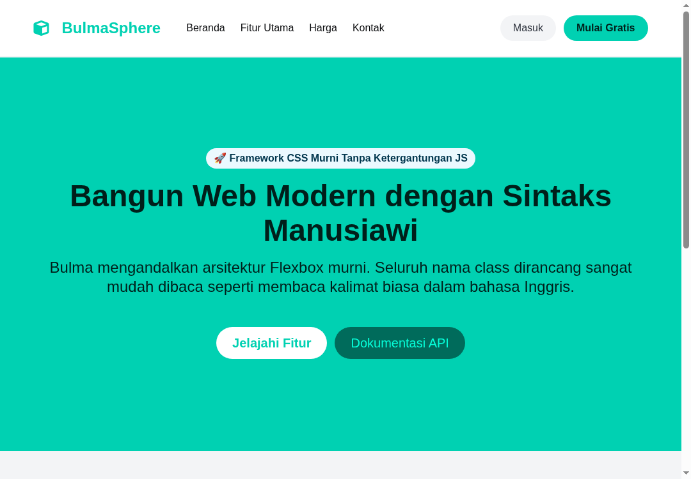

#programming 

Komponen kompleks dalam Bulma dirancang untuk menangani pola desain web tingkat lanjut seperti navigasi responsif, kartu profil konten, dan tata letak media bergaya media sosial.



## 1. Navigasi Responsif (`.navbar`)

Navbar Bulma terdiri dari dua bagian utama:
1. `.navbar-brand`: Selalu terlihat di semua ukuran layar (berisi logo dan tombol burger seluler).
2. `.navbar-menu`: Berisi menu tautan navigasi. Di layar desktop otomatis terbuka horizontal, sedangkan di layar ponsel tersembunyi hingga tombol burger diaktifkan.

### Struktur HTML Navbar Standar

```html
<nav class="navbar is-light" role="navigation" aria-label="main navigation">
  <div class="container">
    <div class="navbar-brand">
      <!-- Logo Perusahaan -->
      <a class="navbar-item" href="#">
        <strong class="has-text-primary is-size-4">BulmaApp</strong>
      </a>

      <!-- Tombol Hamburger Menu Ponsel -->
      <a role="button" class="navbar-burger" aria-label="menu" aria-expanded="false" data-target="navbarMain">
        <span aria-hidden="true"></span>
        <span aria-hidden="true"></span>
        <span aria-hidden="true"></span>
        <span aria-hidden="true"></span>
      </a>
    </div>

    <!-- Menu Tautan -->
    <div id="navbarMain" class="navbar-menu">
      <div class="navbar-start">
        <a class="navbar-item is-active">Beranda</a>
        <a class="navbar-item">Dokumentasi</a>
        <div class="navbar-item has-dropdown is-hoverable">
          <a class="navbar-link">Produk</a>
          <div class="navbar-dropdown">
            <a class="navbar-item">Desain UI</a>
            <a class="navbar-item">Integrasi API</a>
            <hr class="navbar-divider">
            <a class="navbar-item">Dukungan Teknis</a>
          </div>
        </div>
      </div>

      <div class="navbar-end">
        <div class="navbar-item">
          <div class="buttons">
            <a class="button is-primary"><strong>Daftar Akun</strong></a>
            <a class="button is-light">Masuk</a>
          </div>
        </div>
      </div>
    </div>
  </div>
</nav>
```

### Logika JavaScript Pengendali Burger Menu
Karena Bulma adalah framework 100% murni CSS, Anda perlu menambahkan skrip JavaScript sederhana untuk mengaktifkan class `.is-active` saat tombol burger ditekan:

```javascript
document.addEventListener('DOMContentLoaded', () => {
  // Ambil semua elemen dengan class navbar-burger
  const navbarBurgers = Array.prototype.slice.call(document.querySelectorAll('.navbar-burger'), 0);

  navbarBurgers.forEach(el => {
    el.addEventListener('click', () => {
      // Dapatkan target menu berdasarkan atribut data-target
      const target = el.dataset.target;
      const targetMenu = document.getElementById(target);

      // Toggle class is-active pada tombol dan menu
      el.classList.toggle('is-active');
      targetMenu.classList.toggle('is-active');
    });
  });
});
```

## 2. Kartu Konten Multi-Elemen (`.card`)

Komponen `.card` membagi wadah informasi menjadi tiga bagian terstruktur:
1. `.card-image`: Gambar sampul atau header visual.
2. `.card-content`: Bagian badan teks, judul, dan deskripsi.
3. `.card-footer`: Bagian tombol aksi bawah yang terbagi rapi menggunakan `.card-footer-item`.

```html
<div class="card">
  <div class="card-image">
    <figure class="image is-4by3">
      
    </figure>
  </div>
  
  <div class="card-content">
    <div class="media">
      <div class="media-left">
        <figure class="image is-48x48">
          
        </figure>
      </div>
      <div class="media-content">
        <p class="title is-5 mb-0">Aryanda Pratama</p>
        <p class="subtitle is-6">@aryandadev</p>
      </div>
    </div>

    <div class="content mt-3">
      Mempelajari struktur arsitektur CSS framework Bulma untuk membangun sistem desain yang konsisten dan skalabel.
      <br>
      <time datetime="2026-11-03" class="has-text-grey is-size-7">3 November 2026</time>
    </div>
  </div>

  <footer class="card-footer">
    <a href="#" class="card-footer-item has-text-primary">Bagikan</a>
    <a href="#" class="card-footer-item has-text-info">Sunting</a>
    <a href="#" class="card-footer-item has-text-danger">Hapus</a>
  </footer>
</div>
```

## 3. Pola Objek Media Sosial (`.media`)

Class `.media` adalah implementasi klasik pola OOCSS (Object-Oriented CSS) untuk menampilkan deretan komentar, ulasan produk, tweet, atau daftar pesan obrolan.

Struktur komponen:
- `.media-left`: Menampung gambar thumbnail avatar.
- `.media-content`: Menampung teks utama, nama pengirim, dan isi komentar.
- `.media-right`: Menampung tombol aksi tambahan (seperti tombol hapus atau suka).

```html
<article class="media">
  <figure class="media-left">
    <p class="image is-64x64">
      
    </p>
  </figure>
  <div class="media-content">
    <div class="content">
      <p>
        <strong>Rizky Ramadhan</strong> <small>@rizkyr</small> <small>31m</small>
        <br>
        Bulma membuat penataan layout flexbox menjadi jauh lebih sederhana tanpa harus menulis ratusan baris CSS kustom.
      </p>
    </div>
    <nav class="level is-mobile">
      <div class="level-left">
        <a class="level-item"><span class="icon is-small"><i class="fas fa-reply"></i></span></a>
        <a class="level-item"><span class="icon is-small"><i class="fas fa-retweet"></i></span></a>
        <a class="level-item"><span class="icon is-small"><i class="fas fa-heart"></i></span></a>
      </div>
    </nav>
  </div>
  <div class="media-right">
    <button class="delete"></button>
  </div>
</article>
```

---
Lanjutkan pembelajaran ke komponen interaktif: [09. Komponen Interaktif CSS-Only (Modal, Dropdown, dan Tabs)](09.%20Komponen%20Interaktif%20CSS-Only%20(Modal,%20Dropdown,%20dan%20Tabs).md).
