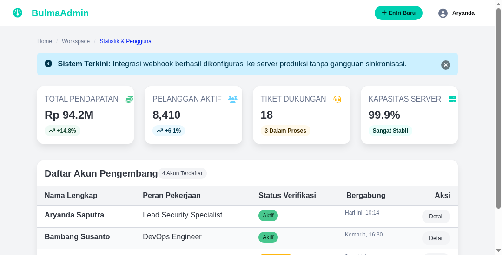

#programming 

Meskipun Bulma 100% murni CSS dan tidak menyertakan script JavaScript runtime, framework ini telah menyediakan seluruh state styling untuk komponen interaktif. Komponen interaktif diaktifkan secara instan cukup dengan menambahkan atau menghapus class status `.is-active`.



## 1. Kotak Dialog Modal (`.modal`)

Komponen modal Bulma menyediakan popup overlay gelap di atas halaman utama. Secara default, modal tersembunyi (`display: none`). Ketika class `.is-active` ditambahkan pada elemen induk `.modal`, dialog akan tampil di layar (`display: flex`).

### Anatomi Modal Kartu (`.modal-card`)
Varian kartu adalah modal yang paling sering digunakan untuk formulir popup atau konfirmasi:
- `.modal-background`: Lapisan transparan gelap penutup latar belakang.
- `.modal-card`: Wadah dialog utama.
- `.modal-card-head`: Bagian kepala dengan judul dan tombol silang `.delete`.
- `.modal-card-body`: Bagian badan isi formulir atau pesan peringatan.
- `.modal-card-foot`: Bagian kaki tombol konfirmasi dan pembatalan.

```html
<!-- Tombol Pemicu Modal -->
<button class="button is-primary" id="btnBukaModal">Buka Formulir</button>

<!-- Komponen Dialog Modal -->
<div class="modal" id="modalTarget">
  <div class="modal-background" id="modalBg"></div>
  <div class="modal-card">
    <header class="modal-card-head">
      <p class="modal-card-title">Tambah Data Proyek Baru</p>
      <button class="delete" aria-label="close" id="btnTutupSilang"></button>
    </header>
    <section class="modal-card-body">
      <div class="field">
        <label class="label">Nama Proyek</label>
        <div class="control">
          <input class="input" type="text" placeholder="Masukkan nama proyek">
        </div>
      </div>
    </section>
    <footer class="modal-card-foot">
      <div class="buttons">
        <button class="button is-success">Simpan Data</button>
        <button class="button" id="btnBatalModal">Batal</button>
      </div>
    </footer>
  </div>
</div>
```

### Kode Pengendali Modal JavaScript Minimalis
```javascript
const modal = document.getElementById('modalTarget');
const bukaBtn = document.getElementById('btnBukaModal');
const tutupSilang = document.getElementById('btnTutupSilang');
const tutupBg = document.getElementById('modalBg');
const batalBtn = document.getElementById('btnBatalModal');

// Buka modal
bukaBtn.addEventListener('click', () => {
  modal.classList.add('is-active');
});

// Tutup modal
const tutupModal = () => modal.classList.remove('is-active');
tutupSilang.addEventListener('click', tutupModal);
tutupBg.addEventListener('click', tutupModal);
batalBtn.addEventListener('click', tutupModal);
```

## 2. Menu Pilihan Dropdown (`.dropdown`)

Bulma mendukung dua jenis interaksi dropdown:

### A. Dropdown Murni CSS (Hover Tanpa JavaScript)
Cukup tambahkan class modifier `.is-hoverable`. Menu akan otomatis muncul ketika kursor pengguna melayang di atas tombol:

```html
<div class="dropdown is-hoverable">
  <div class="dropdown-trigger">
    <button class="button" aria-haspopup="true" aria-controls="dropdown-menu">
      <span>Menu Opsi (Hover)</span>
      <span class="icon is-small"><i class="fas fa-angle-down"></i></span>
    </button>
  </div>
  <div class="dropdown-menu" id="dropdown-menu" role="menu">
    <div class="dropdown-content">
      <a href="#" class="dropdown-item">Profil Pengguna</a>
      <a href="#" class="dropdown-item">Pengaturan Akun</a>
      <hr class="dropdown-divider">
      <a href="#" class="dropdown-item has-text-danger">Keluar Sesi</a>
    </div>
  </div>
</div>
```

### B. Dropdown Berbasis Klik (Click Toggle)
Jika tidak menggunakan `.is-hoverable`, menu dikendalikan dengan men-toggle class `.is-active` pada wadah `.dropdown` saat tombol diklik.

## 3. Bilah Navigasi Tab (`.tabs`)

Komponen `.tabs` mengubah daftar tautan tak berurutan (`<ul>`) menjadi bilah tab horizontal yang elegan:

```html
<div class="tabs is-boxed">
  <ul>
    <li class="is-active">
      <a>
        <span class="icon is-small"><i class="fas fa-chart-line"></i></span>
        <span>Statistik</span>
      </a>
    </li>
    <li>
      <a>
        <span class="icon is-small"><i class="fas fa-users"></i></span>
        <span>Pengguna</span>
      </a>
    </li>
    <li>
      <a>
        <span class="icon is-small"><i class="fas fa-cog"></i></span>
        <span>Konfigurasi</span>
      </a>
    </li>
  </ul>
</div>
```

Modifier gaya tab yang tersedia:
- `is-boxed`: Tab bergaya kotak berkas arsip.
- `is-toggle`: Tab bergaya tombol saklar terhubung.
- `is-rounded`: Tab bergaya tombol oval membulat.
- `is-fullwidth`: Tab membagi lebar secara merata memenuhi wadah.

## 4. Penomoran Halaman Data (`.pagination`)

Komponen `.pagination` digunakan untuk memecah daftar data panjang:

```html
<nav class="pagination is-centered" role="navigation" aria-label="pagination">
  <a class="pagination-previous">Sebelumnya</a>
  <a class="pagination-next">Berikutnya</a>
  <ul class="pagination-list">
    <li><a class="pagination-link is-current" aria-label="Halaman 1" aria-current="page">1</a></li>
    <li><a class="pagination-link" aria-label="Menuju ke halaman 2">2</a></li>
    <li><span class="pagination-ellipsis">&hellip;</span></li>
    <li><a class="pagination-link" aria-label="Menuju ke halaman 10">10</a></li>
  </ul>
</nav>
```

---
Lanjutkan pembelajaran ke kustomisasi tema lanjutan: [10. Kustomisasi Tema dengan Sass dan CSS Variables](10.%20Kustomisasi%20Tema%20dengan%20Sass%20dan%20CSS%20Variables.md).
