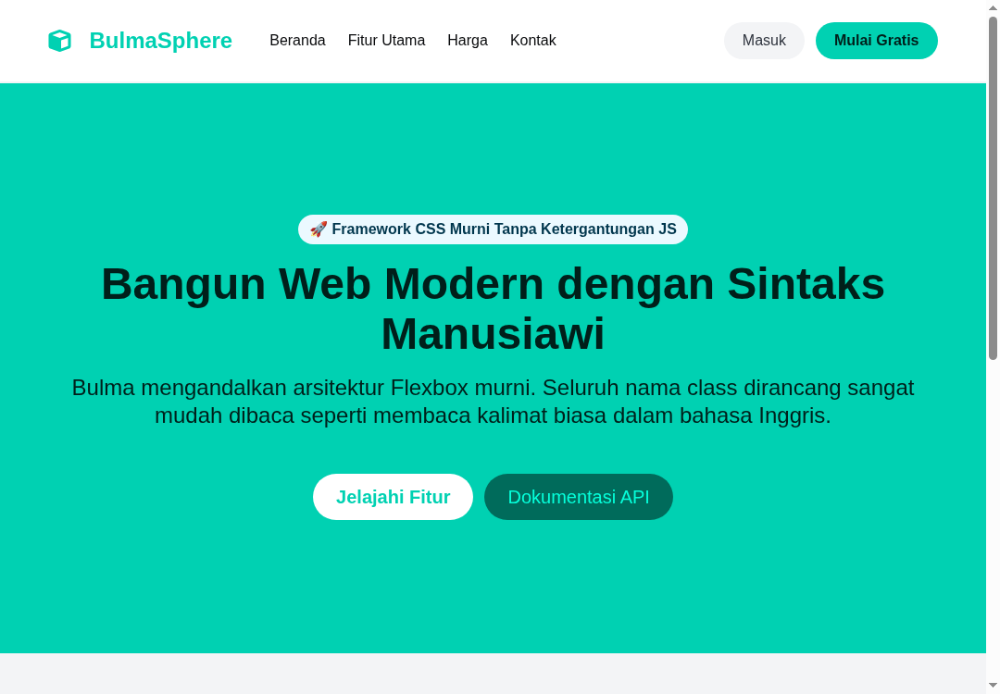
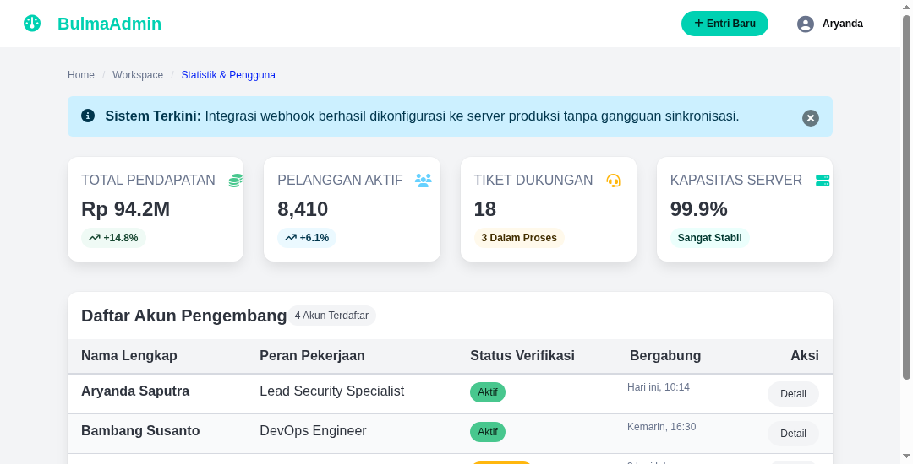

# Catatan Praktikum Bulma CSS

Folder ini berisi kumpulan proyek antarmuka web modern menggunakan Bulma CSS (versi 1.0+). Seluruh berkas HTML menggunakan Bulma CDN resmi sehingga dapat langsung dibuka di peramban web (browser) favorit Anda tanpa memerlukan instalasi Node.js atau kompilasi CSS terpisah.

---

## Daftar Proyek Latihan

### 1. [01-Startup Landing Page](01-startup-landing-page/index.html)
* **Fokus Materi**:
  - Panggung utama Hero banner (`hero is-primary is-medium`).
  - Navbar responsif transparan lengkap dengan script burger menu mandiri.
  - Sistem 3 kolom Flexbox proporsional (`columns` dan `column is-4`).
  - Kartu fitur dengan pola avatar `.media`.
  - Formulir langganan newsletter dengan grup tombol `.field.has-addons`.
* **Pratinjau Desain**:
  

---

### 2. [02-SaaS Admin Panel](02-saas-dashboard/index.html)
* **Fokus Materi**:
  - Komponen kartu statistik ringkas (`.box`) dengan perataan horizontal otomatis (`.level`).
  - Lencana status berbutir bulat penuh (`tag is-rounded`).
  - Tabel data responsif dengan efek sorotan kursor (`table is-fullwidth is-hoverable is-striped`).
  - Jendela pop-up modal tambah data menggunakan struktur resmi `.modal-card` dan toggle class `is-active`.
  - Dropdown menu berbasis CSS murni (`dropdown is-hoverable`).
* **Pratinjau Desain**:
  
