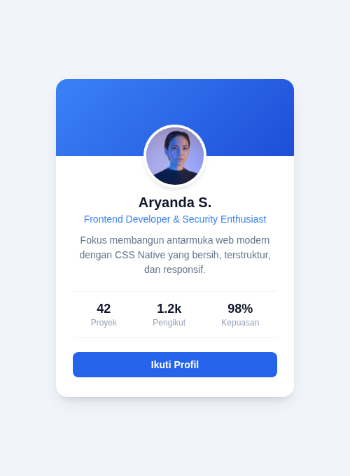

#programming 

Pada materi formatting text kita sudah belajar cara menambahkan efek bayangan pada teks. Di CSS modern, kita juga dapat menambahkan bayangan di sekeliling kotak elemen (*tidak termasuk margin*) dengan menggunakan properti **box-shadow**.

Bayangan memberikan ilusi kedalaman (*depth*) dan elevasi tingkatan layer pada antarmuka web, membuat kartu, tombol, maupun pop-up modal terasa hidup dan mengapung di atas latar belakang.

---

## 1. Sintaks dan Cara Kerja `box-shadow`

```css
selector {
  box-shadow: [offset-x] [offset-y] [blur-radius] [spread-radius] [color];
}
```

Contoh penerapan dasar:

```css
.box {
  width: 200px;
  height: 200px;
  background-color: #a3e635;
  box-shadow: 6px 6px 5px 10px #666666;
}
```

Output:


### Penjelasan Parameter Nilai:
1. **`offset-x` (wajib)**: Jarak pergeseran bayangan secara horizontal. Nilai positif menggeser bayangan ke kanan, nilai negatif menggeser ke kiri.
2. **`offset-y` (wajib)**: Jarak pergeseran bayangan secara vertikal. Nilai positif menggeser bayangan ke bawah, nilai negatif menggeser ke atas.
3. **`blur-radius` (opsional)**: Tingkat keburaman tepi bayangan. Semakin besar angkanya, semakin halus dan kabur bayangannya.
4. **`spread-radius` (opsional)**: Tingkat sebaran atau perluasan bayangan ke segala arah sebelum kabur.
5. **`color` (wajib)**: Warna bayangan. Disarankan menggunakan format `rgba()` atau `hsla()` agar memiliki transparansi yang halus dan realistis.

---

## 2. Teknik Desain Modern: Bayangan Lembut (*Soft Elevation*)

Hindari menggunakan warna hitam pekat `#000000` dengan blur kecil karena bayangan akan terlihat kaku dan kotor. Desain modern menggunakan perpaduan blur besar dengan nilai opacity transparan yang rendah:

```css
/* Bayangan Halus untuk Kartu Modern */
.card-modern {
  background-color: #ffffff;
  border-radius: 12px;
  box-shadow: 0 10px 25px -5px rgba(0, 0, 0, 0.08), 0 8px 10px -6px rgba(0, 0, 0, 0.04);
  transition: transform 0.25s ease, box-shadow 0.25s ease;
}

/* Efek Mengangkat Saat Kursor Melayang (Hover) */
.card-modern:hover {
  transform: translateY(-6px);
  box-shadow: 0 20px 30px -10px rgba(0, 0, 0, 0.15);
}
```

---

## 3. Bayangan ke Dalam Elemen (*Inset Shadow*)

Dengan menambahkan kata kunci `inset` di awal, arah bayangan akan dibalik ke sisi bagian dalam elemen. Sangat cocok untuk kotak input formulir atau efek tombol yang sedang ditekan:

```css
.input-cekung {
  border: 1px solid #cbd5e1;
  box-shadow: inset 0 2px 4px rgba(0, 0, 0, 0.06);
}
```

---

## 4. Hasil Desain di Proyek Nyata

Penerapan bayangan bertingkat (soft shadow) dan efek transisi hover dapat langsung dilihat pada hasil desain Profile Card dan Pricing Table berikut:



Proyek lengkap dapat dicoba langsung pada folder praktek:
- Berkas HTML & CSS: [Praktek 01: Profile Card Modern](praktek/01-profile-card/index.html)
- Berkas HTML & CSS: [Praktek 04: Pricing Table](praktek/04-pricing-table/index.html)
