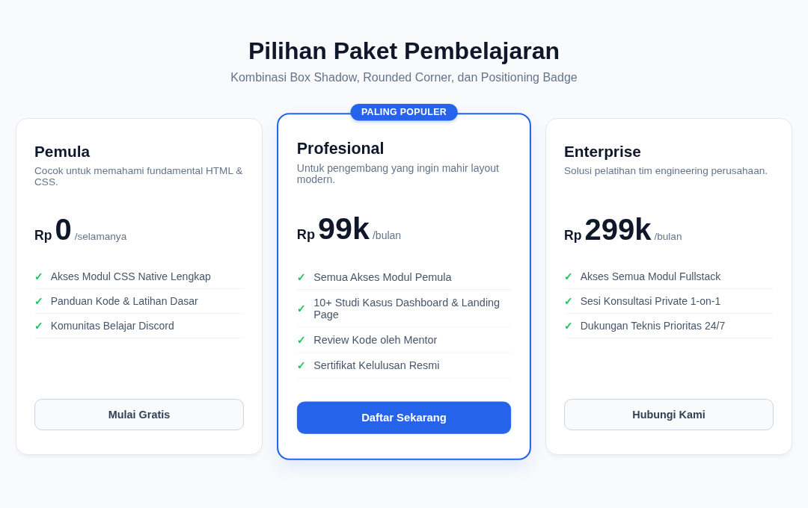

#programming 

CSS3 memperkenalkan kemampuan untuk membuat sudut melengkung (*rounded corner*) pada kotak elemen dengan menggunakan properti **border-radius**.

Lengkungan sudut membantu menciptakan antarmuka yang ramah, modern, dan tidak kaku, mulai dari kartu profil berujung melengkung halus hingga avatar lingkaran penuh.

---

## 1. Sintaks Dasar dan Cara Kerja

Nilai dari properti `border-radius` menentukan radius lengkungan sudut dalam satuan piksel (`px`), persen (`%`), atau rem:

```html
<p class="rounded">
  Contoh paragraf dengan sudut kotak melengkung halus.
</p>
```

```css
.rounded {
  width: 300px;
  padding: 20px;
  border: 4px solid deeppink;
  border-radius: 10px;
}
```

Output:


---

## 2. Mengatur Tiap Sudut Secara Individual

Kita bisa menetapkan nilai berbeda pada masing-masing sudut menggunakan properti individual:

```css
.rounded-kustom {
  border-top-left-radius: 16px;     /* Pojok kiri atas */
  border-top-right-radius: 0px;      /* Pojok kanan atas tajam */
  border-bottom-right-radius: 16px;  /* Pojok kanan bawah */
  border-bottom-left-radius: 0px;   /* Pojok kiri bawah tajam */
}
```

### Format Shorthand (Putaran Searah Jarum Jam):
Urutan nilainya adalah: `top-left`, `top-right`, `bottom-right`, `bottom-left`.

```css
.rounded-shorthand {
  border-radius: 16px 0px 16px 0px;
}
```

---

## 3. Pola Desain Populer di Antarmuka Web

### A. Foto Profil / Avatar Lingkaran Sempurna (`50%`)
Jika elemen memiliki nilai `width` dan `height` yang sama (persegi), memberikan `border-radius: 50%` akan memotong kotak menjadi lingkaran sempurna:

```css
.avatar {
  width: 90px;
  height: 90px;
  border-radius: 50%;
  object-fit: cover;
}
```

### B. Tombol Kapsul / Badge Lonjong (*Pill Shape*)
Dengan memberikan nilai radius yang sangat besar (seperti `20px` atau `9999px`), kedua ujung tombol atau badge otomatis menjadi setengah lingkaran:

```css
.badge-kapsul {
  padding: 4px 14px;
  border-radius: 20px;
  background-color: #2563eb;
  color: #ffffff;
}
```

---

## 4. Hasil Penerapan Nyata

Penerapan `border-radius` untuk kartu melengkung, badge kapsul, dan tombol interaktif dapat dilihat pada hasil desain Pricing Table berikut:



Proyek lengkap dapat dicoba langsung pada folder praktek:
- Berkas HTML & CSS: [Praktek 04: Modern Pricing Cards](praktek/04-pricing-table/index.html)
- Berkas HTML & CSS: [Praktek 01: Profile Card Modern](praktek/01-profile-card/index.html)
