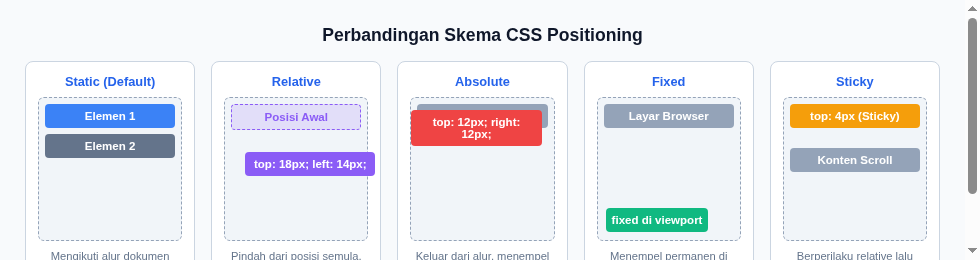
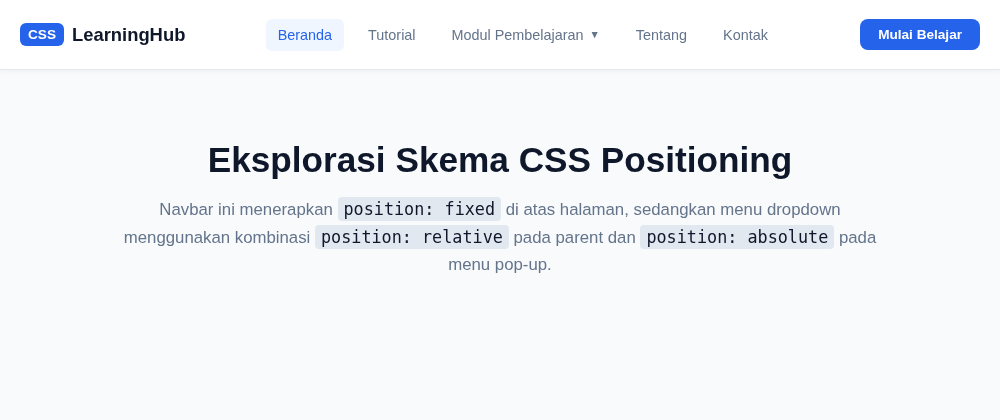

#programming 

Kita sudah mengetahui cara mengubah posisi dari sebuah elemen dengan menggunakan margin. Namun, saat melakukannya posisi elemen lain di sekitarnya ikut terdorong atau bergeser. Lantas bagaimana jika kita ingin memindahkan elemen tanpa mengganggu posisi elemen lainnya? Solusinya adalah mengubah skema pemosisian (*positioning schema*) dengan menggunakan properti **position**.



Properti `position` menentukan bagaimana elemen diletakkan pada halaman dan bagaimana koordinat `top`, `right`, `bottom`, `left`, serta tumpukan kedalaman `z-index` dihitung.

---

## 1. Skema Nilai Properti Position

CSS menyediakan lima nilai utama untuk properti `position`:

| Nilai | Status Alur (*Flow*) | Relatif Terhadap | Keterangan |
| :--- | :--- | :--- | :--- |
| **`static`** | Normal Flow | Posisi alami dokumen | Nilai default elemen. Properti `top`, `right`, `bottom`, `left`, dan `z-index` tidak berpengaruh. |
| **`relative`** | Normal Flow (tetap memesan ruang) | Posisi aslinya sendiri | Bergeser dari posisi semula tanpa mengganggu elemen lain. Ruang aslinya tetap dipertahankan. |
| **`absolute`** | Out of Flow (keluar dari alur) | Parent `relative` terdekat | Ruang aslinya hilang seolah elemen terangkat. Koordinat dihitung dari elemen induk berposisi non-static. |
| **`fixed`** | Out of Flow (keluar dari alur) | Jendela browser (*viewport*) | Menempel permanen di layar meski halaman di-scroll ke bawah. Sangat umum untuk navbar atau tombol chat. |
| **`sticky`** | Gabungan `relative` dan `fixed` | Elemen scroll container | Mengikuti alur normal hingga menyentuh batas koordinat layar yang ditentukan, lalu menempel seperti fixed. |

---

## 2. Bedah Detail Skema Positioning

### A. Static (Default)
Elemen dengan `position: static` mengikuti aturan dasar dokumen web: elemen block membuat baris baru dari atas ke bawah, sedangkan elemen inline berjejer dari kiri ke kanan.

```css
.kotak {
  position: static; /* Nilai bawaan, tidak bisa digeser dengan top/left */
}
```

### B. Relative Positioning
Ketika kita memberi `position: relative`, elemen bisa digeser menggunakan properti offset (`top`, `bottom`, `left`, `right`).

```css
.kotak-relative {
  position: relative;
  top: 20px;   /* Geser 20px ke bawah dari posisi semula */
  left: 30px;  /* Geser 30px ke kanan dari posisi semula */
}
```
Poin penting: Elemen di sekitarnya tidak akan terdorong karena ruang kosong tempat semula elemen berada tetap dipesan di halaman.

### C. Absolute Positioning
Elemen dengan `position: absolute` dicabut sepenuhnya dari alur normal dokumen (*out of normal flow*). Elemen lain di bawahnya akan naik mengisi ruang yang ditinggalkan.

```css
.induk {
  position: relative; /* Menjadi titik acuan (anchor) */
  width: 400px;
  height: 250px;
}

.anak-badge {
  position: absolute;
  top: 10px;
  right: 10px;        /* Menempel persis di pojok kanan atas elemen .induk */
}
```

> Kunci Sukses: Pola **Parent Relative, Child Absolute** adalah pola desain paling populer di CSS untuk membuat label promo, ikon notifikasi, lencana badge, maupun menu pop-up.

### D. Fixed Positioning
Elemen fixed selalu berpatokan pada layar browser (viewport). Berapa pun panjang halaman di-scroll oleh pengguna, posisinya tidak akan pernah berpindah.

```css
.navbar-fixed {
  position: fixed;
  top: 0;
  left: 0;
  width: 100%;
  height: 60px;
  z-index: 999; /* Memastikan navbar berada di atas konten lain */
}
```

### E. Sticky Positioning
Sticky adalah perpaduan unik. Awalnya elemen berperilaku seperti `relative` mengikuti alur scroll, namun begitu posisi scroll menyentuh batas (misalnya `top: 0`), ia langsung beralih menjadi `fixed` menempel di layar sampai batas container induknya habis.

```css
.header-tabel {
  position: sticky;
  top: 0;
  background-color: #ffffff;
}
```

---

## 3. Mengatur Tumpukan Layer dengan `z-index`

Saat beberapa elemen berposisi saling bertumpukan atau tumpang tindih, kita mengatur siapa yang berada di lapisan paling depan menggunakan `z-index`:

- Nilai `z-index` berupa bilangan bulat (positif atau negatif), contoh: `z-index: 10;`.
- Semakin besar angka `z-index`, semakin di depan posisi tumpukannya di layar.
- **Catatan Penting**: `z-index` hanya bekerja pada elemen yang memiliki properti `position` bernilai `relative`, `absolute`, `fixed`, atau `sticky` (tidak berfungsi pada `static`).

---

## 4. Contoh Nyata & Hasil Desain

Penerapan kombinasi `position: fixed` pada navbar dan pola `relative + absolute` pada menu dropdown dapat dilihat pada proyek latihan berikut:



Proyek lengkap dapat dicoba langsung pada folder praktek:
- Berkas HTML & CSS: [Praktek 02: Navbar & Dropdown Menu](praktek/02-navbar-dropdown/index.html)
