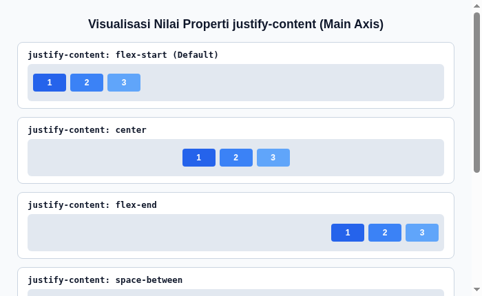
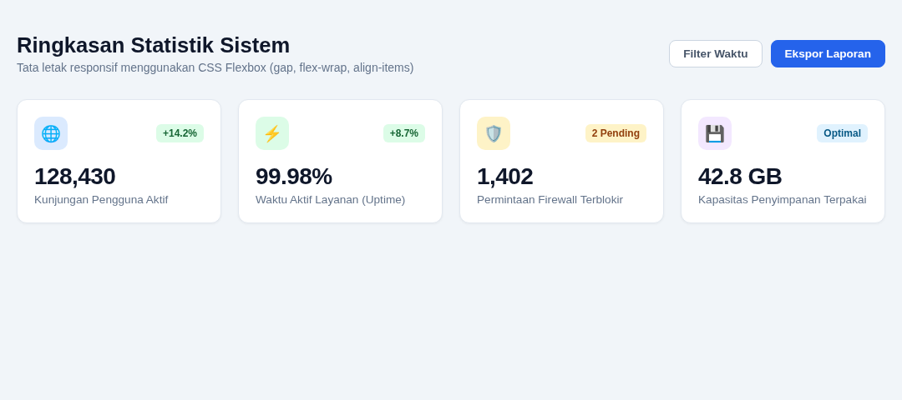

#programming 

**Flexible Box Layout** atau **Flexbox** adalah model tata letak (layout) satu dimensi yang dirancang untuk menyusun elemen anak (*flex items*) di dalam elemen induk (*flex container*) baik secara mendatar (baris / row) maupun menurun (kolom / column).

Sebelum hadirnya Flexbox, pembuatan tata letak web sering mengandalkan `float` dan trik `positioning` yang rumit, mudah patah, dan sulit untuk memposisikan elemen tepat di tengah secara vertikal. Flexbox hadir memberikan fleksibilitas penuh: elemen dapat otomatis membesar mengisi ruang kosong, menciut jika ruang sempit, serta membagi jarak secara merata.


---

## 1. Konsep Dasar & Sumbu Flexbox

Di dalam Flexbox ada dua sumbu arah utama:
1. **Main Axis (Sumbu Utama)**: Arah default tempat flex items dijejerkan. Arahnya ditentukan oleh properti `flex-direction`.
2. **Cross Axis (Sumbu Silang)**: Sumbu yang tegak lurus dengan Main Axis. Jika Main Axis horizontal (kiri ke kanan), maka Cross Axis adalah vertikal (atas ke bawah).

---

## 2. Properti untuk Elemen Induk (Flex Container)

Properti berikut diterapkan langsung pada elemen pembungkus (*parent element*):

### A. Mengaktifkan Flexbox (`display: flex`)
```css
.container {
  display: flex; /* Mengubah container menjadi flex container */
}
```

### B. Menentukan Arah (`flex-direction`)
Mengatur arah penyusunan flex items:
- `row` (default): Berjejer mendatar dari kiri ke kanan.
- `row-reverse`: Berjejer mendatar dari kanan ke kiri.
- `column`: Menumpuk menurun dari atas ke bawah.
- `column-reverse`: Menumpuk dari bawah ke atas.

```css
.container {
  display: flex;
  flex-direction: row; /* atau column */
}
```

### C. Pembagian Posisi pada Sumbu Utama (`justify-content`)
Mengontrol bagaimana ruang kosong di sumbu utama didistribusikan ke item-item:



- `flex-start` (default): Item berkumpul di awal container.
- `center`: Semua item berkumpul tepat di tengah.
- `flex-end`: Item berkumpul di ujung akhir container.
- `space-between`: Item pertama di awal, item terakhir di ujung, jarak antar item dibagi rata.
- `space-around`: Setiap item memiliki jarak rata di kiri dan kanannya.
- `space-evenly`: Jarak antara item dan dinding pembatas bernilai sama persis.

### D. Perataan pada Sumbu Silang (`align-items`)
Mengatur perataan vertikal (atau silang) dari item:
- `stretch` (default): Item meregang memenuhi tinggi container.
- `center`: Item berada tepat di tengah sumbu silang.
- `flex-start`: Item merapat ke bagian atas container.
- `flex-end`: Item merapat ke bagian bawah container.

```css
.container {
  display: flex;
  justify-content: center; /* Tengah horizontal */
  align-items: center;     /* Tengah vertikal (Perfect Centering) */
  height: 300px;
}
```

### E. Penanganan Pembungkusan Baris (`flex-wrap`)
Menentukan apakah item dipaksa dalam satu baris atau boleh melompat ke baris baru saat layar mengecil:
- `nowrap` (default): Semua item dipaksa dalam satu baris (berisiko overflow jika terlalu sempit).
- `wrap`: Item akan otomatis turun ke baris baru saat ruang horizontal habis.

```css
.container {
  display: flex;
  flex-wrap: wrap;
}
```

### F. Memberikan Jarak Celah (`gap`)
Cara modern dan paling bersih untuk memberi jarak antar flex items tanpa perlu trik `margin`:

```css
.container {
  display: flex;
  gap: 20px;          /* Jarak 20px di baris dan kolom */
  row-gap: 15px;      /* Jarak antar baris saja */
  column-gap: 25px;   /* Jarak antar kolom saja */
}
```

---

## 3. Properti untuk Elemen Anak (Flex Items)

Properti berikut diterapkan pada masing-masing child element di dalam container:

### A. Pembesaran dan Penciutan (`flex-grow`, `flex-shrink`, `flex-basis`)
1. **`flex-grow`**: Menentukan seberapa besar item akan membesar mengisi sisa ruang kosong (default: `0`).
2. **`flex-shrink`**: Menentukan kemampuan item untuk mengecil jika ruang container terlalu sempit (default: `1`).
3. **`flex-basis`**: Ukuran awal item sebelum sisa ruang didistribusikan (default: `auto`).

> **Tips Singkat (Shorthand `flex`)**:
> Developer umumnya menggunakan shorthand `flex: 1;` yang setara dengan `flex: 1 1 0;` agar semua item memiliki porsi lebar yang sama rata secara dinamis.

```css
.sidebar {
  flex: 0 0 250px; /* Lebar tetap 250px, tidak membesar maupun menciut */
}

.main-content {
  flex: 1;         /* Mengisi seluruh sisa ruang yang tersedia */
}
```

### B. Perataan Individual (`align-self`)
Digunakan jika ada satu item tertentu yang ingin memiliki perataan silang berbeda dari item lainnya:

```css
.item-khusus {
  align-self: flex-end; /* Hanya item ini yang merapat ke bawah */
}
```

### C. Urutan Tampilan (`order`)
Mengubah urutan visual item tanpa mengubah struktur kode HTML (default: `order: 0`). Nilai lebih kecil akan tampil lebih awal.

---

## 4. Studi Kasus Desain: Responsive Dashboard Cards

Penerapan Flexbox yang paling umum adalah menyusun kumpulan kartu (*cards*) statistik yang otomatis menyesuaikan diri pada berbagai ukuran layar menggunakan `flex-wrap: wrap` dan `gap`:



Proyek lengkap dapat dicoba langsung pada folder praktek:
- Berkas HTML & CSS: [Praktek 03: Flexbox Dashboard Cards](praktek/03-flexbox-dashboard-cards/index.html)
