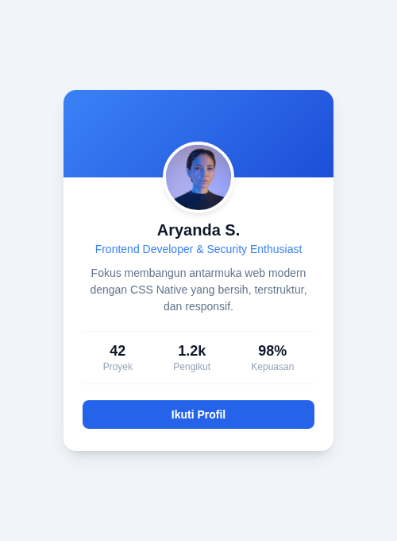
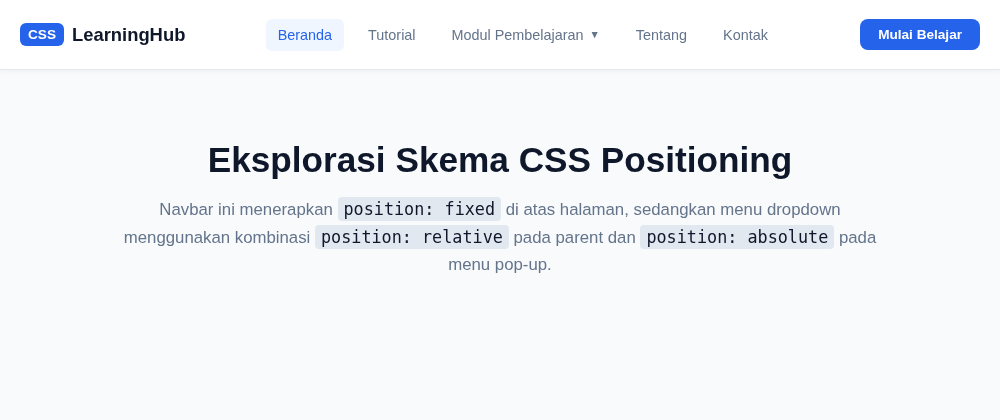
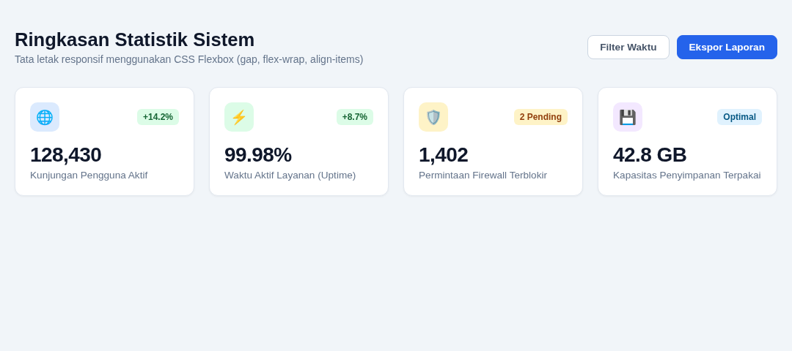
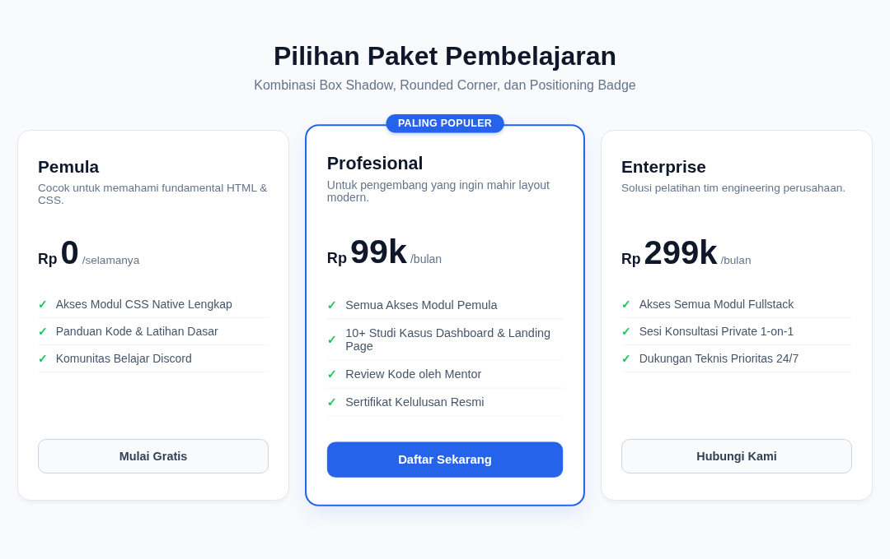

# Catatan Praktikum CSS Native

Folder ini berisi kumpulan proyek antarmuka (UI) mandiri untuk menguji dan mempraktekkan langsung teori CSS Native yang telah dipelajari di catatan modul.

Setiap subfolder berisi berkas `index.html` dan `styles.css`. Anda dapat membuka berkas `index.html` langsung di browser Chrome, Firefox, atau Edge tanpa memerlukan web server tambahan.

---

## Daftar Proyek Latihan

### 1. [01-Profile Card Modern](01-profile-card/index.html)
* **Fokus Materi**: Box Model, Padding, Margin, Border Radius (50% Avatar), Multi-layer Soft Box Shadow, dan Transisi Hover.
* **Tangkapan Layar Desain**:
  

---

### 2. [02-Navbar & Dropdown Menu](02-navbar-dropdown/index.html)
* **Fokus Materi**: `position: fixed` pada header atas, pola Parent `relative` + Child `absolute` pada menu pop-up dropdown, serta status pseudo-class `:hover`.
* **Tangkapan Layar Desain**:
  

---

### 3. [03-Flexbox Dashboard Cards](03-flexbox-dashboard-cards/index.html)
* **Fokus Materi**: `display: flex`, `justify-content: space-between`, perataan vertikal `align-items: center`, `flex-wrap: wrap`, dan spasi modern `gap: 20px`.
* **Tangkapan Layar Desain**:
  

---

### 4. [04-Modern Pricing Table](04-pricing-table/index.html)
* **Fokus Materi**: Hierarki visual kartu unggulan (featured card), ribbon badge melayang dengan `position: absolute`, hover elevation (`transform: translateY(-6px)`), dan tombol kapsul (*pill shape*).
* **Tangkapan Layar Desain**:
  
