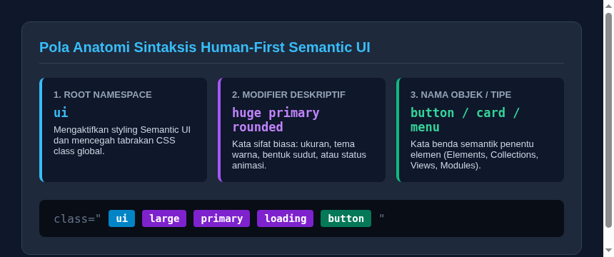

#programming 

**Semantic UI** adalah framework pengembangan antarmuka web yang dirancang dengan filosofi *natural language conventions*, yaitu memperlakukan kode HTML dan CSS layaknya tata bahasa percakapan manusia sehari-hari. Diciptakan oleh Jack Lukic pada tahun 2013, framework ini mengubah cara penulisan class CSS dari kode singkatan kriptik menjadi kalimat logis yang mudah dipahami oleh programmer maupun desainer.



## 1. Filosofi Sintaksis Human-First

Jika framework tradisional menggunakan singkatan teknis seperti `btn btn-primary btn-lg` atau utility atomik seperti `px-4 py-2 bg-blue-600 rounded`, Semantic UI menggunakan frasa deskriptif bahasa Inggris yang mengalir:

```html
<!-- Contoh pada Semantic UI -->
<button class="ui large primary button">
  Kirim Pesan
</button>

<button class="ui tiny red inverted loading button">
  Memproses
</button>
```

Aturan pembacaan sintaksis Semantic UI selalu mengikuti pola tiga bagian:
1. **Root Namespace (`ui`)**: Menandakan bahwa elemen tersebut dikelola oleh Semantic UI dan mengisolasi styling agar tidak merusak class CSS global lainnya.
2. **Modifiers (Kata Sifat)**: Menentukan ukuran (`mini`, `tiny`, `small`, `medium`, `large`, `big`, `huge`, `massive`), warna (`primary`, `secondary`, `red`, `blue`, `teal`), bentuk (`rounded`, `circular`, `fluid`), atau status (`active`, `disabled`, `loading`).
3. **Noun (Kata Benda Pokok)**: Menyatakan jenis komponen, seperti `button`, `menu`, `card`, `segment`, atau `modal`.

## 2. Lima Kategori Definisi Komponen

Semantic UI mengelompokkan ratusan komponen antarmukanya ke dalam 5 kategori arsitektur yang terstruktur:

| Kategori | Definisi | Contoh Komponen |
| :--- | :--- | :--- |
| **Elements** | Blok bangunan visual terkecil yang tidak dapat dipecah lagi tanpa kehilangan fungsinya. | Button, Container, Divider, Header, Icon, Image, Input, Label, Loader, Segment. |
| **Collections** | Gabungan beberapa elemen yang bekerja sama membentuk struktur layout atau interaksi kelompok. | Breadcrumb, Form, Grid, Menu, Message, Table. |
| **Views** | Pola tampilan visual yang umum ditemukan pada aplikasi modern untuk menyajikan informasi kompleks. | Card, Comment, Feed, Item, Statistic, Advertisement. |
| **Modules** | Komponen interaktif tingkat lanjut yang perilakunya dikendalikan oleh plugin JavaScript. | Accordion, Checkbox, Dimmer, Dropdown, Modal, Popup, Progress, Rating, Sidebar, Tab. |
| **Behaviors** | Utilitas logika tanpa wujud visual mandiri yang memicu aksi tertentu pada antarmuka. | Form Validation, API Querying, State Management. |

## 3. Hubungan Semantic UI dan Fomantic-UI

Dalam perkembangannya, repositori resmi Semantic UI sempat mengalami perlambatan pembaruan. Komunitas pengembang frontend kemudian menginisiasi fork komunitas resmi bernama **Fomantic-UI**.

- **Fomantic-UI** adalah kelanjutan resmi yang 100% kompatibel penuh dengan kode Semantic UI lama.
- Menyediakan perbaikan bug berkala, dukungan komponen baru (seperti Slider, Toast, Calendar, dan Range), serta kompatibilitas dengan versi jQuery terbaru dan standar CSS modern.
- Seluruh class, konsep sintaksis, dan struktur grid yang dipelajari pada Semantic UI berlaku identik pada Fomantic-UI.

---
Lanjutkan pembelajaran ke modul berikutnya: [02. Instalasi dan Setup](02.%20Instalasi%20dan%20Setup.md).
