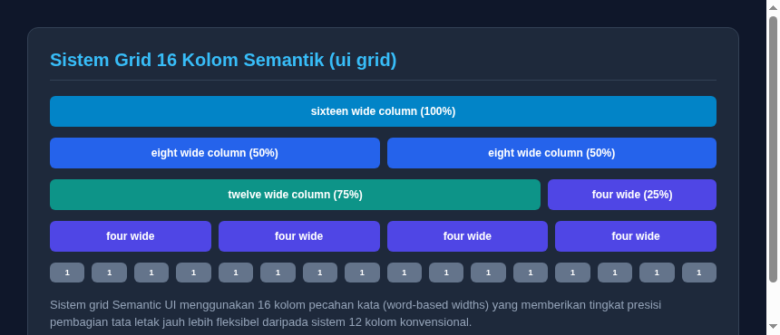

#programming 

Berbeda dengan sebagian besar framework CSS yang menggunakan sistem 12 kolom, Semantic UI mengadopsi **sistem grid 16 kolom**. Pilihan arsitektur 16 kolom memberikan pembagian pecahan biner yang sangat simetris dan presisi (dapat dibagi rata menjadi 1, 2, 4, 8, dan 16).



## 1. Struktur Dasar: `ui grid`, `row`, dan `column`

Grid di Semantic UI didefinisikan dengan membungkus elemen kolom di dalam kontainer bertipe `ui grid`:

```html
<div class="ui grid">
  <div class="eight wide column">
    <div class="ui segment">Setengah Layar (8 dari 16)</div>
  </div>
  <div class="eight wide column">
    <div class="ui segment">Setengah Layar (8 dari 16)</div>
  </div>
</div>
```

Jika total lebar kolom dalam satu baris melebihi 16, kolom berikutnya akan otomatis turun membentuk baris baru secara alami. Anda juga dapat menggunakan pembungkus `<div class="row">` secara eksplisit jika ingin memisahkan baris dengan aturan perataan tertentu.

## 2. Penentuan Lebar Berbasis Kata (Word-Based Widths)

Semantic UI tidak menggunakan angka mentah dalam class, melainkan kata bilangan bahasa Inggris:

| Class Kolom | Porsi Lebar | Persentase |
| :--- | :--- | :--- |
| `sixteen wide column` | 16 / 16 | 100% |
| `twelve wide column` | 12 / 16 | 75% |
| `eight wide column` | 8 / 16 | 50% |
| `four wide column` | 4 / 16 | 25% |
| `two wide column` | 2 / 16 | 12.5% |
| `one wide column` | 1 / 16 | 6.25% |

Contoh tata letak artikel utama dengan bilah samping (sidebar):

```html
<div class="ui grid">
  <!-- Area Konten Utama (75% lebar) -->
  <div class="twelve wide column">
    <div class="ui segment">Konten Artikel Utama</div>
  </div>

  <!-- Sidebar Kanan (25% lebar) -->
  <div class="four wide column">
    <div class="ui segment">Widget Sidebar</div>
  </div>
</div>
```

## 3. Pembagian Kolom Otomatis (Equal Width & N-Column Grid)

Jika Anda tidak ingin menulis lebar kolom satu per satu, Semantic UI menyediakan dua opsi praktis:

### A. Kolom Otomatis Rata (`equal width grid`)
Setiap kolom anak akan otomatis mendapatkan lebar yang sama rata tanpa perlu menentukan class wide:

```html
<div class="ui equal width grid">
  <div class="column"><div class="ui segment">1</div></div>
  <div class="column"><div class="ui segment">2</div></div>
  <div class="column"><div class="ui segment">3</div></div>
</div>
```

### B. Jumlah Kolom Seragam per Baris (`n-column grid`)
Terapkan jumlah kolom langsung pada elemen induk grid:
```html
<div class="ui three column grid">
  <div class="column"><div class="ui segment">Kolom A</div></div>
  <div class="column"><div class="ui segment">Kolom B</div></div>
  <div class="column"><div class="ui segment">Kolom C</div></div>
</div>
```

## 4. Penataan Responsif (Stackable dan Doubling)

### A. Grid yang Menumpuk di Layar Ponsel (`stackable grid`)
Secara default, kolom akan tetap mempertahankan lebarnya. Agar kolom otomatis menumpuk secara vertikal menjadi satu kolom penuh saat dibuka di layar ponsel seluler (di bawah 768px), tambahkan modifier `stackable`:

```html
<div class="ui stackable four column grid">
  <div class="column"><div class="ui segment">Kartu 1</div></div>
  <div class="column"><div class="ui segment">Kartu 2</div></div>
  <div class="column"><div class="ui segment">Kartu 3</div></div>
  <div class="column"><div class="ui segment">Kartu 4</div></div>
</div>
```

### B. Grid Berlipat Ganda (`doubling grid`)
Modifier `doubling` akan melipatgandakan ukuran kolom secara bertahap saat resolusi layar mengecil. Misalnya, grid 6 kolom di desktop akan menjadi 3 kolom di tablet, dan menjadi 1 kolom di ponsel.

## 5. Perataan Posisi (Centered dan Vertikal)

- **`centered grid`**: Memposisikan kolom berada persis di tengah horizontal jika total lebar kolom kurang dari 16.
- **`middle aligned grid`**: Meratakan isi seluruh kolom secara vertikal di garis tengah.
- **`relaxed grid`**: Memberikan jarak celah (gutter) antarkolom yang lebih lapang.

```html
<div class="ui centered grid">
  <div class="eight wide column">
    <div class="ui segment">Kolom Ini Terpusat Rapi di Tengah Layar</div>
  </div>
</div>
```

---
Lanjutkan pembelajaran ke elemen visual dasar: [04. Elemen Antarmuka Esensial (Button, Header, Segment, dan Icon)](04.%20Elemen%20Antarmuka%20Esensial%20(Button,%20Header,%20Segment,%20dan%20Icon).md).
