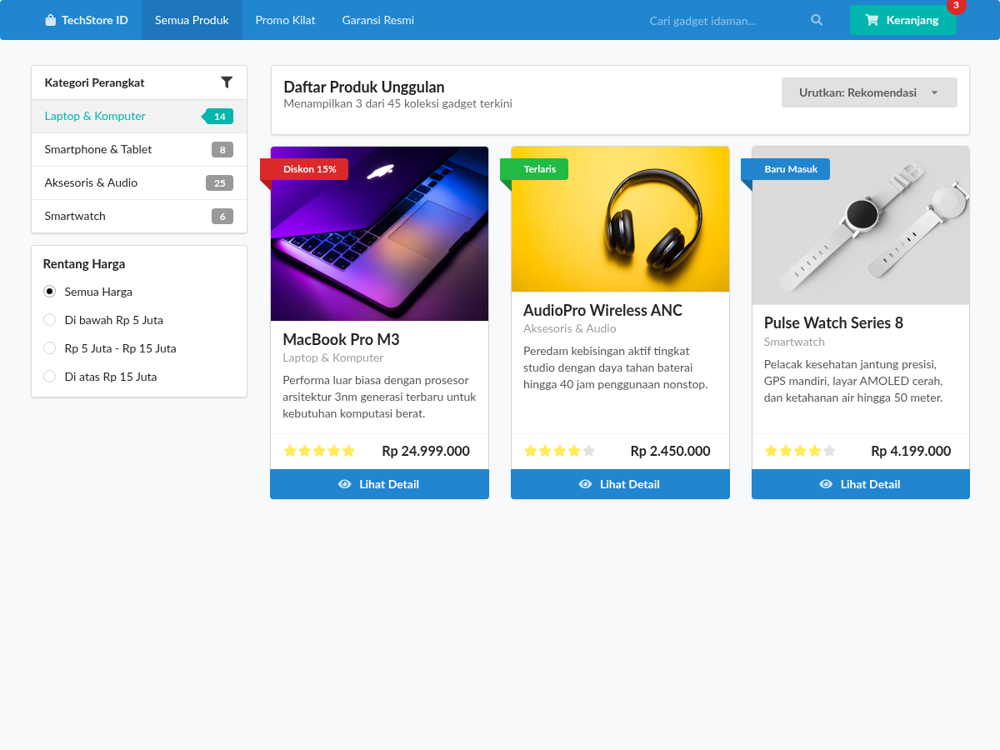

#programming 

Kategori **Views** dalam Semantic UI menghadirkan pola antarmuka tingkat lanjut untuk menyajikan informasi visual yang kaya, seperti kartu etalase produk, ringkasan indikator kinerja utama (KPI), serta linimasa aktivitas pengguna.



## 1. Kartu Konten Multi-Elemen (`ui card` dan `ui cards`)

Komponen kartu dirancang untuk menyajikan unit informasi terpadu:

```html
<div class="ui card">
  <div class="image">
    <!-- Pita Promosi Melayang -->
    <div class="ui red ribbon label">Diskon 20%</div>
    
  </div>
  <div class="content">
    <a class="header">Ultrabook Pro 14</a>
    <div class="meta">
      <span class="date">Dirilis Oktober 2026</span>
    </div>
    <div class="description">
      Laptop performa tinggi dengan ketahanan baterai sepanjang hari untuk para profesional kreatif.
    </div>
  </div>
  <div class="extra content">
    <span class="right floated">
      <i class="star icon text yellow"></i>
      4.9 (128 ulasan)
    </span>
    <span>
      <i class="shopping cart icon"></i>
      Stok Tersedia
    </span>
  </div>
  <div class="ui bottom attached primary button">
    Beli Sekarang
  </div>
</div>
```

### Wadah Kelompok Kartu (`ui cards`)
Untuk menata deretan kartu secara otomatis dengan tinggi yang seragam, bungkus di dalam kontainer `ui cards`. Anda dapat menentukan jumlah kolom per baris serta menambahkan modifier responsif:

```html
<div class="ui three stackable cards">
  <div class="ui card">Kartu 1</div>
  <div class="ui card">Kartu 2</div>
  <div class="ui card">Kartu 3</div>
</div>
```

## 2. Metrik Statistik Angka (`ui statistic` dan `ui statistics`)

Class `ui statistic` digunakan untuk menonjolkan angka penting pada dasbor analitik bisnis atau ringkasan capaian:

```html
<div class="ui statistic">
  <div class="value">
    <i class="users icon text blue"></i> 12.450
  </div>
  <div class="label">
    Pengguna Terdaftar
  </div>
</div>
```

### Deretan Statistik Terpadu (`ui statistics`)
Menampilkan beberapa metrik secara berdampingan:

```html
<div class="ui four statistics segment">
  <div class="statistic">
    <div class="value">Rp 250 Jt</div>
    <div class="label">Total Omzet</div>
  </div>
  <div class="statistic">
    <div class="value">99.8%</div>
    <div class="label">Kepuasan Pelanggan</div>
  </div>
  <div class="statistic">
    <div class="value">14 Menit</div>
    <div class="label">Rata-Rata Respons</div>
  </div>
  <div class="statistic">
    <div class="value">42</div>
    <div class="label">Proyek Selesai</div>
  </div>
</div>
```

Modifier statistik yang tersedia:
- Ukuran: `mini`, `tiny`, `small`, `large`, `huge`.
- Warna: `red`, `orange`, `yellow`, `olive`, `green`, `teal`, `blue`, `violet`, `purple`, `pink`.
- Format mendatar: `horizontal statistic` (label diletakkan di samping kanan angka).

## 3. Linimasa Aktivitas Sosial (`ui feed`)

Komponen `ui feed` menyajikan daftar kronologis peristiwa yang terjadi di dalam aplikasi (seperti umpan media sosial atau riwayat log audit):

```html
<div class="ui feed">
  <div class="event">
    <div class="label">
      
    </div>
    <div class="content">
      <div class="summary">
        <a class="user">Aryanda Pratama</a> menambahkan repositori baru ke organisasi
        <div class="date">3 menit yang lalu</div>
      </div>
      <div class="extra text">
        Modul arsitektur Semantic UI untuk sistem desain berbasis kata semantik.
      </div>
      <div class="meta">
        <a class="like"><i class="like icon"></i> 14 Suka</a>
      </div>
    </div>
  </div>

  <div class="event">
    <div class="label">
      <i class="server icon text green"></i>
    </div>
    <div class="content">
      <div class="summary">
        Node cluster server Jakarta berhasil melakukan pemulihan otomatis
        <div class="date">1 jam yang lalu</div>
      </div>
    </div>
  </div>
</div>
```

---
Lanjutkan pembelajaran ke modul interaktif: [08. Modul Interaktif JavaScript (Modal, Dropdown, dan Accordion)](08.%20Modul%20Interaktif%20JavaScript%20(Modal,%20Dropdown,%20dan%20Accordion).md).
