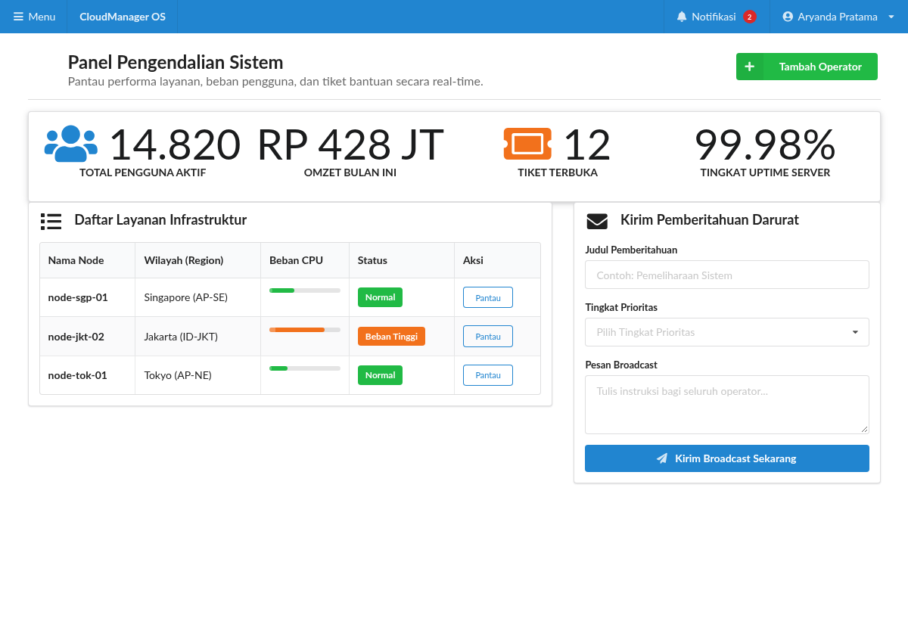

#programming 

Kategori **Modules** dalam Semantic UI merupakan sekumpulan komponen antarmuka tingkat lanjut yang perilakunya dikendalikan oleh plugin JavaScript. Komponen ini menyediakan transisi visual yang halus, pengelolaan status interaksi, serta penanganan peristiwa pengguna yang intuitif.



## 1. Kotak Dialog Pop-up (`ui modal`)

Komponen modal Semantic UI menampilkan dialog melayang di atas layar dengan latar belakang gelap peredam (dimmer) terpasang otomatis:

```html
<!-- Tombol Pemicu -->
<button class="ui primary button" id="btnBukaModal">
  Buka Formulir Modal
</button>

<!-- Komponen Dialog Modal -->
<div class="ui small modal" id="modalPengguna">
  <i class="close icon"></i>
  <div class="header">
    Konfirmasi Pendaftaran Operator
  </div>
  <div class="content">
    <div class="description">
      <div class="ui header">Apakah data yang Anda masukkan sudah benar?</div>
      <p>Operator yang telah didaftarkan akan langsung menerima tautan aktivasi akun ke alamat surel yang dicantumkan.</p>
    </div>
  </div>
  <div class="actions">
    <div class="ui black deny button">
      Batal
    </div>
    <div class="ui positive right labeled icon button">
      Ya, Simpan Operator
      <i class="checkmark icon"></i>
    </div>
  </div>
</div>
```

### Logika JavaScript Pengendali Modal
```javascript
// Inisialisasi dan pemicu buka modal
$('#btnBukaModal').on('click', function() {
  $('#modalPengguna').modal({
    closable: false, // Mencegah modal tertutup jika pengguna mengklik area luar
    onDeny: function() {
      console.log('Pengguna membatalkan aksi.');
    },
    onApprove: function() {
      alert('Operator berhasil disimpan ke basis data.');
    }
  }).modal('show');
});
```

Modifier ukuran modal: `mini`, `tiny`, `small`, `large`, `fullscreen`.

## 2. Menu Pilihan Lanjutan (`ui dropdown`)

Dropdown Semantic UI bukan sekadar tag `<select>` HTML biasa, melainkan antarmuka interaktif yang mendukung pencarian cepat (searchable), pemilihan ganda (multi-select), serta penambahan ikon:

### A. Dropdown Seleksi Berpencarian (`search selection dropdown`)
```html
<div class="ui search selection dropdown" id="dropdownNegara">
  <input type="hidden" name="negara">
  <i class="dropdown icon"></i>
  <div class="default text">Pilih Negara</div>
  <div class="menu">
    <div class="item" data-value="id"><i class="id flag"></i> Indonesia</div>
    <div class="item" data-value="sg"><i class="sg flag"></i> Singapura</div>
    <div class="item" data-value="my"><i class="my flag"></i> Malaysia</div>
    <div class="item" data-value="jp"><i class="jp flag"></i> Jepang</div>
  </div>
</div>
```

Inisialisasi JavaScript:
```javascript
$('#dropdownNegara').dropdown({
  fullTextSearch: true
});
```

### B. Dropdown Pemilihan Ganda (Multiple Selection)
Cukup tambahkan class `multiple`:
```html
<div class="ui fluid multiple search selection dropdown" id="dropdownKeahlian">
  <input type="hidden" name="keahlian">
  <i class="dropdown icon"></i>
  <div class="default text">Pilih Keahlian Teknis</div>
  <div class="menu">
    <div class="item" data-value="html">HTML5</div>
    <div class="item" data-value="css">CSS3</div>
    <div class="item" data-value="js">JavaScript</div>
    <div class="item" data-value="docker">Docker</div>
  </div>
</div>
```
```javascript
$('#dropdownKeahlian').dropdown();
```

## 3. Panel Lipat Interaktif (`ui accordion`)

Accordion digunakan untuk menghemat ruang vertikal layar dengan menyembunyikan konten penjelasan di balik judul yang dapat diklik (seperti halaman FAQ):

```html
<div class="ui styled fluid accordion" id="faqAccordion">
  <div class="active title">
    <i class="dropdown icon"></i>
    Apa perbedaan Semantic UI dengan framework lainnya?
  </div>
  <div class="active content">
    <p>Semantic UI menggunakan sintaks bahasa manusia yang alami serta memisahkan arsitektur komponen menjadi Elements, Collections, Views, Modules, dan Behaviors.</p>
  </div>

  <div class="title">
    <i class="dropdown icon"></i>
    Apakah Semantic UI membutuhkan library eksternal?
  </div>
  <div class="content">
    <p>Untuk komponen statis hanya membutuhkan CSS, sedangkan modul interaktif seperti modal dan dropdown memanfaatkan pustaka jQuery.</p>
  </div>

  <div class="title">
    <i class="dropdown icon"></i>
    Bagaimana cara kerja Fomantic-UI?
  </div>
  <div class="content">
    <p>Fomantic-UI adalah kelanjutan resmi komunitas yang 100% kompatibel penuh dengan kode Semantic UI lama dan terus diperbarui secara aktif.</p>
  </div>
</div>
```

Inisialisasi JavaScript:
```javascript
$('#faqAccordion').accordion({
  exclusive: true // Hanya satu panel yang terbuka dalam satu waktu
});
```

---
Lanjutkan pembelajaran ke modul interaktif dinamis: [09. Komponen Interaktif Dinamis (Sidebar, Dimmer, Tab, dan Rating)](09.%20Komponen%20Interaktif%20Dinamis%20(Sidebar,%20Dimmer,%20Tab,%20dan%20Rating).md).
