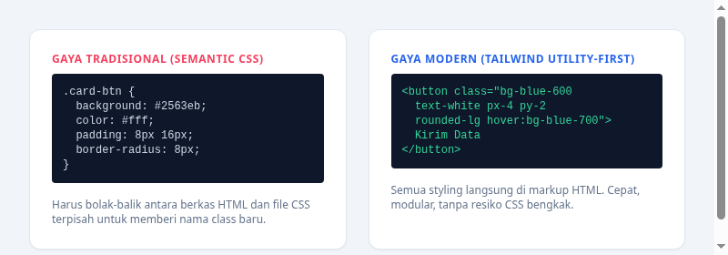

#programming 

**Tailwind CSS** adalah sebuah [framework](Framework.md) CSS berorientasi *utility-first* yang dirancang untuk membangun antarmuka web modern dengan cepat tanpa perlu meninggalkan berkas HTML atau JSX Anda.

Berbeda dengan framework CSS tradisional seperti Bootstrap atau Bulma yang menyediakan komponen siap pakai dengan gaya baku (seperti `.btn`, `.card`, `.navbar`), Tailwind menyediakan ribuan class utilitas tingkat rendah (*low-level utility classes*) seperti `flex`, `pt-4`, `text-center`, dan `rotate-90` yang dapat dikombinasikan langsung untuk membangun desain apa pun secara bebas.

---

## 1. Masalah pada Pendekatan CSS Tradisional

Ketika menggunakan CSS Native tradisional atau Semantic CSS, pengembang web sering menghadapi kendala klasik berikut:

1. **Kelelahan Menamai Class (*Naming Fatigue*)**:
   Pengembang menghabiskan banyak waktu hanya untuk memikirkan nama class, seperti `.wrapper`, `.inner-container`, `.sidebar-card-header-title-text`.
2. **Ukuran Berkas CSS Terus Membengkak**:
   Setiap kali ada fitur baru atau halaman baru dibuat, developer menulis baris CSS baru. Berkas stylesheet menjadi ribuan baris dan sulit dihapus karena takut merusak halaman lain.
3. **Konflik Spesifisitas (*CSS Specificity War*)**:
   Styling yang bertumpuk-tumpuk sering saling menimpa, memaksa developer menggunakan selector panjang atau jalan pintas buruk seperti `!important`.

---

## 2. Keunggulan Utama Tailwind CSS

1. **Tidak Ada Masalah Penamaan Class**:
   Anda tidak perlu menciptakan nama class baru untuk setiap variasi tombol atau kartu. Cukup susun class utilitas langsung di elemen HTML.
2. **Ukuran File CSS Hasil Produksi Sangat Kecil**:
   Tailwind dilengkapi mesin kompilasi cerdas (*Just-In-Time / JIT engine*). Mesin ini memindai seluruh berkas proyek Anda dan **hanya menyertakan class yang benar-benar Anda pakai**. Rata-rata berkas CSS produksi Tailwind berukuran di bawah 10 KB.
3. **Sistem Desain yang Konsisten (*Design System Constraint*)**:
   Tailwind membatasi pilihan warna, ukuran jarak (*spacing*), dan bayangan pada skala yang proporsional dan harmonis. Anda tidak akan secara tidak sengaja menggunakan jarak acak seperti `margin: 13px;` atau warna abu-abu yang sedikit meleset.
4. **Dukungan Responsif dan State Bawaan**:
   Mengatur tampilan mobile, efek hover saat kursor melayang, hingga tema gelap (*dark mode*) cukup dilakukan dengan menambahkan awalan (*prefix*) sederhana seperti `md:flex`, `hover:bg-blue-700`, dan `dark:bg-slate-900`.

---

## 3. Mitos Populer Seputar Tailwind

* **"Bukankah ini sama saja seperti Inline Styles (`style='...'`)?"**
  Tidak sama. Inline styles tidak mendukung media queries untuk responsive design, tidak bisa menangani pseudo-class seperti `:hover` dan `:focus`, serta tidak memiliki batasan sistem desain. Tailwind memberikan kemudahan seperti inline style dengan seluruh kekuatan penuh CSS modern.
* **"Apakah HTML menjadi kotor dan panjang?"**
  Di awal terlihat padat, namun dalam pengembangan web modern (berbasis komponen seperti React, Vue, Blade, atau Astro), class yang panjang ini dibungkus rapi di dalam komponen modular sehingga tidak pernah ditulis berulang kali.
