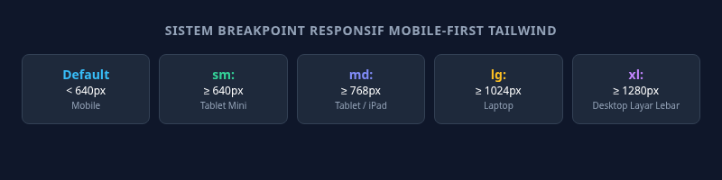

#programming 

Tailwind CSS menerapkan filosofi desain **Mobile-First**. Artinya, setiap class utilitas tanpa awalan akan berlaku untuk semua ukuran layar (dimulai dari layar ponsel terkecil 0px), dan kita menambahkan awalan (*breakpoint prefix*) untuk menentukan bagaimana tampilan berubah saat layar semakin lebar.



---

## 1. Daftar Breakpoint Bawaan Tailwind

Tailwind menggunakan lima titik henti (*breakpoints*) standar berbasis media query `min-width`:

| Awalan (*Prefix*) | Lebar Layar Minimum | Target Perangkat Tipikal |
| :--- | :--- | :--- |
| *(tanpa awalan)* | `0px` ke atas | Seluruh layar ponsel (smartphone portrait) |
| **`sm:`** | `640px` ke atas | Ponsel layar lebar / Smartphone landscape |
| **`md:`** | `768px` ke atas | Komputer tablet (iPad, Galaxy Tab) |
| **`lg:`** | `1024px` ke atas | Laptop dan monitor komputer desktop kecil |
| **`xl:`** | `1280px` ke atas | Monitor komputer desktop layar lebar |
| **`2xl:`** | `1536px` ke atas | Layar televisi atau monitor ultra-wide |

---

## 2. Cara Kerja Alur Mobile-First

Aturan emas dalam Tailwind: **Tulis desain untuk layar HP terlebih dahulu, lalu tambahkan perubahannya di layar yang lebih besar**.

```html
<!-- Contoh Tata Letak Kartu Responsif -->
<div class="w-full md:w-1/2 lg:w-1/3">...</div>
```
Penjelasan Logika:
1. Pada layar ponsel (< 768px), elemen memiliki lebar `w-full` (100% selebar layar).
2. Begitu layar mencapai ukuran tablet (>= 768px), aturan `md:w-1/2` aktif, membuat elemen membagi layar menjadi 50%.
3. Saat layar mencapai ukuran laptop (>= 1024px), aturan `lg:w-1/3` aktif, membuat elemen menjadi 33.3% (tiga kartu per baris).

---

## 3. Contoh Kasus Nyata: Navigasi Responsif

Pola navigasi yang menyembunyikan link di HP dan memunculkannya di layar tablet/desktop:

```html
<nav class="flex items-center justify-between p-4 bg-white border-b">
  <div class="font-bold text-lg">BrandLogo</div>

  <!-- Tombol Menu Hamburger: Hanya tampil di HP, sembunyi di desktop -->
  <button class="block md:hidden p-2 text-slate-700">
    ☰
  </button>

  <!-- Link Navigasi: Sembunyi di HP, tampil rapi berjejer di desktop -->
  <div class="hidden md:flex gap-6 text-sm font-medium">
    <a href="#" class="hover:text-blue-600">Beranda</a>
    <a href="#" class="hover:text-blue-600">Layanan</a>
    <a href="#" class="hover:text-blue-600">Tentang</a>
    <a href="#" class="hover:text-blue-600">Kontak</a>
  </div>
</nav>
```

---

## 4. Tipografi Responsif

Ukuran judul besar yang nyaman di layar laptop sering kali terlalu besar hingga pecah di layar ponsel. Gunakan breakpoint untuk memperbesar font secara bertahap:

```html
<h1 class="text-3xl sm:text-4xl lg:text-6xl font-extrabold text-slate-900 leading-tight">
  Judul yang Menyesuaikan Diri
</h1>
```

---

## 5. Kesalahan Umum yang Harus Dihindari

> **Hindari Pemikiran Terbalik**:
> Jangan menggunakan `sm:` dengan asumsi untuk menargetkan layar ponsel! Jika Anda menulis `sm:text-center`, maka teks Anda justru rata kiri di HP dan baru menjadi rata tengah saat layar dibuka di tablet.
> 
> **Cara yang Benar**:
> Tulis `text-center md:text-left` (rata tengah di HP secara default, lalu berubah rata kiri saat masuk layar tablet/desktop).
