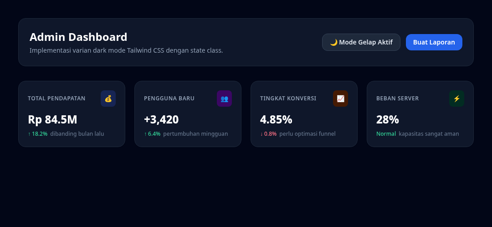

#programming 

Dukungan tema gelap (*dark mode*) merupakan fitur standar wajib pada aplikasi web modern. Tailwind menyediakan varian `dark:` yang membuat proses penataan gaya mode malam menjadi sangat mudah tanpa perlu menulis file stylesheet terpisah.

---

## 1. Dua Strategi Dark Mode di Tailwind

Di dalam berkas `tailwind.config.js`, Anda dapat memilih satu dari dua strategi:

```js
// tailwind.config.js
module.exports = {
  darkMode: 'class', // atau 'media'
  content: ["./src/**/*.{html,js}"],
  theme: { extend: {} },
}
```

### A. Strategi Media (`darkMode: 'media'`)
Secara otomatis mendeteksi pengaturan sistem operasi pengguna melalui media query `prefers-color-scheme`. Jika pengguna menyetel Windows atau macOS ke mode gelap, website Anda otomatis menjadi gelap.

### B. Strategi Class (`darkMode: 'class'`) - Paling Direkomendasikan
Tailwind akan mengaktifkan varian gelap jika tag induk teratas `<html>` memiliki class `dark`. Strategi ini memberikan kendali penuh kepada pengguna untuk mengganti tema secara manual menggunakan tombol saklar (*toggle switch*) yang tersimpan di `localStorage`.

---

## 2. Cara Menggunakan Varian `dark:`

Cukup pasangkan warna mode terang bersama warna mode gelapnya secara berdampingan:

```html
<div class="bg-white dark:bg-slate-900 text-slate-800 dark:text-slate-100 border border-slate-200 dark:border-slate-800 p-6 rounded-2xl shadow-sm">
  <h2 class="text-xl font-bold">Kartu Adaptif</h2>
  <p class="text-sm text-slate-500 dark:text-slate-400 mt-2">
    Otomatis berubah warna mengikuti tema aktif.
  </p>
</div>
```

Pola Pasangan Warna Standar:
* **Background Utama**: `bg-slate-50 dark:bg-slate-950`
* **Background Kartu**: `bg-white dark:bg-slate-900`
* **Garis Tepi (Border)**: `border-slate-200 dark:border-slate-800`
* **Judul Teks**: `text-slate-900 dark:text-white`
* **Teks Sekunder**: `text-slate-500 dark:text-slate-400`

---

## 3. Skrip Tombol Pengganti Tema (*Toggle Switcher*)

Berikut adalah logika JavaScript sederhana untuk mengganti tema dan menyimpannya di browser pengguna:

```html
<button id="themeToggle" class="px-4 py-2 bg-slate-200 dark:bg-slate-800 rounded-lg text-sm font-semibold">
  Ganti Tema
</button>

<script>
  const toggleBtn = document.getElementById('themeToggle');

  // Cek preferensi tersimpan atau preferensi sistem
  if (localStorage.theme === 'dark' || (!('theme' in localStorage) && window.matchMedia('(prefers-color-scheme: dark)').matches)) {
    document.documentElement.classList.add('dark');
  } else {
    document.documentElement.classList.remove('dark');
  }

  // Aksi tombol klik
  toggleBtn.addEventListener('click', () => {
    if (document.documentElement.classList.contains('dark')) {
      document.documentElement.classList.remove('dark');
      localStorage.theme = 'light';
    } else {
      document.documentElement.classList.add('dark');
      localStorage.theme = 'dark';
    }
  });
</script>
```

---

## 4. Hasil Penerapan Nyata

Contoh penerapan panel admin lengkap dengan tombol switch tema gelap dan kartu statistik dapat dilihat pada proyek latihan berikut:



Proyek lengkap dapat dicoba langsung pada folder praktek:
- Berkas HTML: [Praktek 02: Dark Mode & Dashboard Cards](praktek/02-dark-mode-dashboard/index.html)
