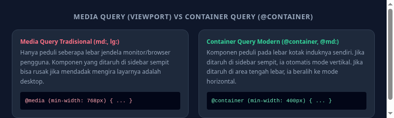

#programming 

**Container Queries** adalah salah satu terobosan terbesar dalam sejarah CSS modern. Jika media query tradisional (`sm:`, `md:`, `lg:`) hanya merespons perubahan ukuran jendela browser secara keseluruhan, maka Container Query memungkinkan sebuah komponen beradaptasi berdasarkan **lebar ruang kotak induknya sendiri**.



---

## 1. Masalah Besar pada Media Query Tradisional

Bayangkan Anda membuat sebuah komponen kartu profil pengguna (`<UserCard />`).
* Jika kartu tersebut ditaruh di halaman utama yang luas (lebar 1000px), Anda ingin fotonya berada di kiri dan teksnya di kanan (`flex-row`).
* Jika kartu yang sama ditaruh di sidebar samping yang sempit (lebar 250px), Anda ingin fotonya berada di atas dan teksnya di bawah (`flex-col`).

Dengan media query biasa (`md:flex-row`), kartu tersebut akan **rusak di sidebar layar desktop** karena browser mendeteksi bahwa layar laptop Anda berukuran besar (> 768px), padahal kolom sidebar tempat kartu berada lebarnya sangat sempit.

---

## 2. Pemasangan Plugin Container Queries (Tailwind v3)

Pada Tailwind CSS v3, pasang plugin resmi:

```bash
npm install -D @tailwindcss/container-queries
```

Daftarkan di berkas konfigurasi:
```js
// tailwind.config.js
module.exports = {
  plugins: [
    require('@tailwindcss/container-queries'),
  ],
}
```
*(Catatan: Pada Tailwind CSS v4, fitur container queries sudah didukung secara bawaan tanpa perlu memasang plugin tambahan).*

---

## 3. Cara Penggunaan: `@container` dan Awalan `@{size}:`

### Langkah 1: Tandai Elemen Induk sebagai Container
Beri class `@container` pada elemen pembungkus tempat komponen akan ditaruh:

```html
<div class="@container">
  <!-- Elemen anak di dalamnya sekarang bisa menggunakan breakpoint container -->
</div>
```

### Langkah 2: Gunakan Breakpoint Container pada Elemen Anak
Gunakan simbol `@` di depan ukuran breakpoint (`@sm:`, `@md:`, `@lg:`, `@xl:`):

| Breakpoint Container | Lebar Minimum Induk |
| :--- | :--- |
| **`@sm:`** | `384px` |
| **`@md:`** | `448px` |
| **`@lg:`** | `512px` |
| **`@xl:`** | `576px` |
| **`@2xl:`** | `672px` |

---

## 4. Contoh Komponen Mandiri Sejati

Perhatikan bagaimana kartu berikut otomatis berubah bentuk tergantung di mana pun ia diletakkan:

```html
<!-- Container Pembungkus -->
<div class="@container">
  <!-- Kartu: Default vertikal (column), tapi jika container >= 448px beralih ke horizontal (row) -->
  <div class="flex flex-col @md:flex-row items-center gap-4 p-4 bg-white rounded-xl border shadow-sm">
    
    <div class="text-center @md:text-left">
      <h3 class="font-bold text-slate-900 @md:text-lg">Aryanda S.</h3>
      <p class="text-xs text-slate-500">Security & Frontend Engineer</p>
    </div>
  </div>
</div>
```

Kini komponen Anda 100% modular dan bebas dipindahkan ke sidebar, dialog modal kecil, footer, maupun area panggung utama tanpa pernah mengalami kerusakan tata letak.
