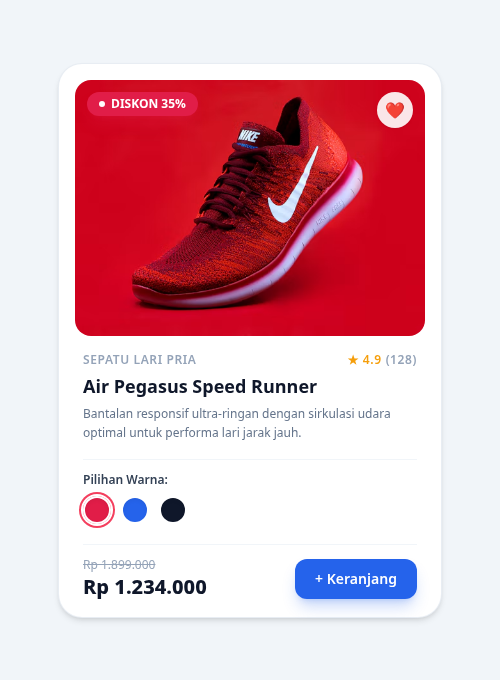
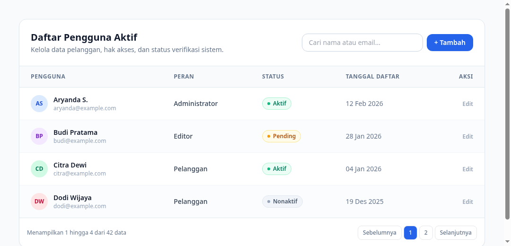

# Catatan Praktikum Tailwind CSS

Folder ini berisi kumpulan 4 proyek antarmuka web modern menggunakan Tailwind CSS. Seluruh berkas HTML menggunakan Tailwind Play CDN sehingga Anda dapat langsung membukanya di peramban web (browser) favorit Anda tanpa perlu setup Node.js terlebih dahulu.

---

## Daftar Proyek Latihan

### 1. [01-Modern SaaS Hero Section](01-modern-hero-section/index.html)
* **Fokus Materi**:
  - Sticky header dengan efek blur kaca (`backdrop-blur-md bg-white/80`).
  - Efek teks gradasi modern (`bg-gradient-to-r bg-clip-text text-transparent`).
  - Tombol aksi dengan efek bayangan warna dan micro-interaction (`hover:-translate-y-0.5 active:scale-95`).
  - Tata letak responsif penuh (Mobile, Tablet, Desktop) menggunakan prefix `sm:`, `md:`, dan `lg:`.
* **Pratinjau Desain**:
  

---

### 2. [02-Dark Mode & Dashboard Cards](02-dark-mode-dashboard/index.html)
* **Fokus Materi**:
  - Pengaturan Tailwind Dark Mode dengan strategi class (`darkMode: 'class'`).
  - Tombol switcher JavaScript interaktif untuk mengganti tema gelap dan terang.
  - Kartu statistik modular dengan warna teks dan background adaptif (`bg-white dark:bg-slate-900`).
  - Grid responsif 4 kolom yang otomatis menyesuaikan ukuran layar (`grid-cols-1 sm:grid-cols-2 lg:grid-cols-4`).
* **Pratinjau Desain**:
  

---

### 3. [03-E-Commerce Product Card](03-ecommerce-product-card/index.html)
* **Fokus Materi**:
  - Zoom halus pada gambar saat kartu di-hover (`group-hover:scale-110 transition-transform duration-500`).
  - Lencana diskon mencolok dengan efek denyut animasi (`animate-pulse`).
  - Pemilihan varian warna interaktif menggunakan CSS modern `:has()` selector (`has-[:checked]:ring-2`).
  - Rating bintang, harga coret, dan tombol belanja dengan umpan balik klik (`active:scale-95`).
* **Pratinjau Desain**:
  

---

### 4. [04-Interactive Admin Data Table](04-interactive-data-table/index.html)
* **Fokus Materi**:
  - Baris tabel belang-belang (*striped rows*) menggunakan modifier `even:bg-slate-50/50`.
  - Sorotan baris interaktif saat kursor melayang (`hover:bg-blue-50/40`).
  - Penataan padding seluruh sel header menggunakan arbitrary child selector `[&>tr>th]:py-3.5`.
  - Lencana status berbutir warna (*status pills*) dan bar navigasi pagination terintegrasi.
* **Pratinjau Desain**:
  
