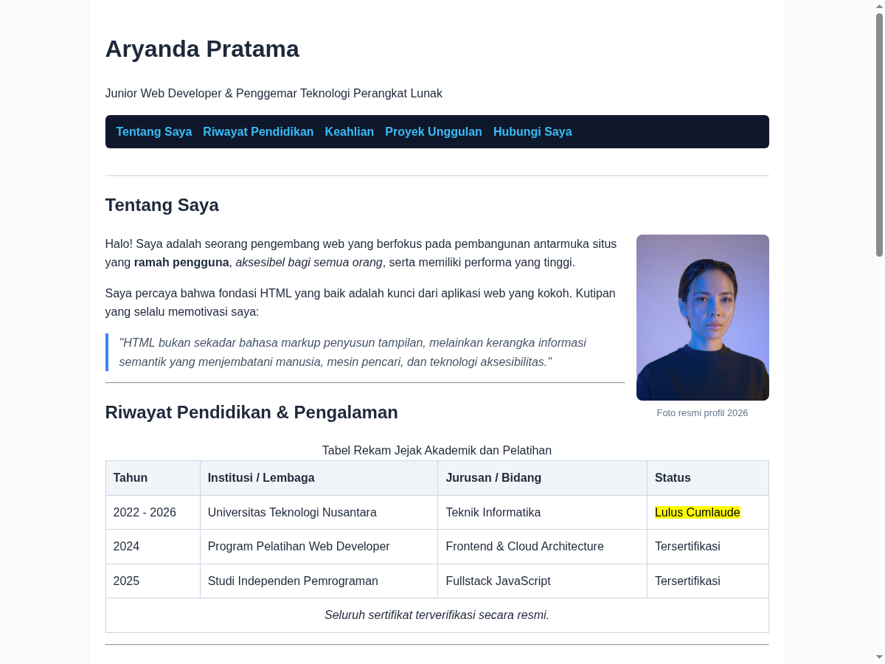
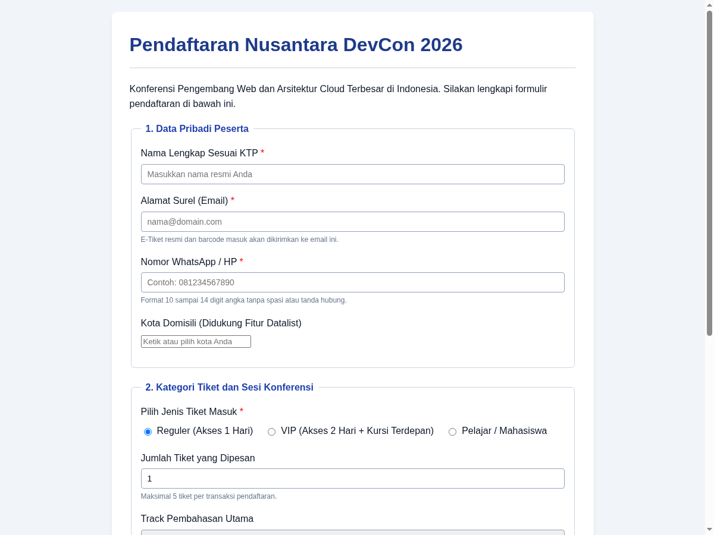

#roadmap 

### Tahap 1: Fondasi dan Kerangka Dokumen
1. [Pengenalan HTML](01.%20Pengenalan%20HTML.md)
2. [Struktur Dokumen HTML5](02.%20Struktur%20Dokumen%20HTML5.md)

### Tahap 2: Tipografi, Pemformatan Teks dan Navigasi
3. [Heading dan Hirarki Konten](03.%20Heading%20dan%20Hirarki%20Konten.md)
4. [Paragraf dan Teks Format](04.%20Paragraf%20dan%20Teks%20Format.md)
5. [Block Formatting Text](05.%20Block%20Formatting%20Text.md)
6. [Inline Formatting Semantik](06.%20Inline%20Formatting%20Semantik.md)
7. [Hyperlink dan Navigasi](07.%20Hyperlink%20dan%20Navigasi.md)
8. [List dan Penomoran](08.%20List%20dan%20Penomoran.md)

### Tahap 3: Media Visual, Audio, Video dan Tabel
9. [Gambar dan Media Grafis](09.%20Gambar%20dan%20Media%20Grafis.md)
10. [Audio, Video, dan Embed Iframe](10.%20Audio,%20Video,%20dan%20Embed%20Iframe.md)
11. [Tabel Data Terstruktur](11.%20Tabel%20Data%20Terstruktur.md)

### Tahap 4: Semantik Halaman dan Komponen Interaktif
12. [Generic Element (Div dan Span)](12.%20Generic%20Element%20Div%20dan%20Span.md)
13. [Semantic HTML dan Struktur Halaman](13.%20Semantic%20HTML%20dan%20Struktur%20Halaman.md)
14. [Elemen Interaktif HTML5](14.%20Elemen%20Interaktif%20HTML5.md)

### Tahap 5: Formulir dan Pengolahan Data Pengguna
15. [Formulir dan Input Pengguna](15.%20Formulir%20dan%20Input%20Pengguna.md)
16. [Validasi dan Pengiriman Formulir](16.%20Validasi%20dan%20Pengiriman%20Formulir.md)

### Tahap 6: Aksesibilitas Modern dan Optimasi SEO
17. [Aksesibilitas Web (A11y) dan ARIA](17.%20Aksesibilitas%20Web%20A11y%20dan%20ARIA.md)
18. [Metadata Dokumen dan SEO](18.%20Metadata%20Dokumen%20dan%20SEO.md)

---

### Proyek Praktik Terapan

Untuk memperkuat pemahaman konsep, modul ini dilengkapi dengan 2 proyek implementasi kode yang dapat diuji langsung di peramban:

#### 1. Halaman Web Portofolio Profil Pribadi Semantik
- Lokasi Kode Sumber: [01-personal-portfolio/index.html](praktek/01-personal-portfolio/index.html)
- Fitur yang Diterapkan: Struktur semantik lengkap (`header`, `nav`, `main`, `section`, `article`, `figure`, `blockquote`, tabel riwayat pendidikan, formulir kontak).

#### 2. Formulir Registrasi Nusantara DevCon 2026
- Lokasi Kode Sumber: [02-event-registration-form/index.html](praktek/02-event-registration-form/index.html)
- Fitur yang Diterapkan: Kontrol input modern (`datalist`, `optgroup`, validasi regex `pattern`, `min`/`max`, akordion `
`/`
`, dan modal dialog natif `<dialog>`).

Dokumentasi lengkap proyek dapat dibaca pada [Panduan Praktik HTML](praktek/README.md).
